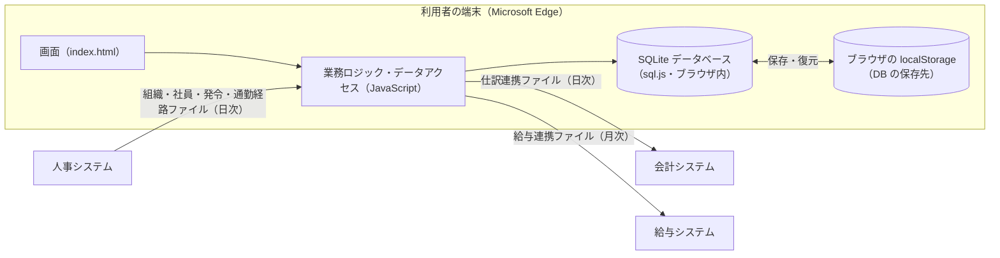
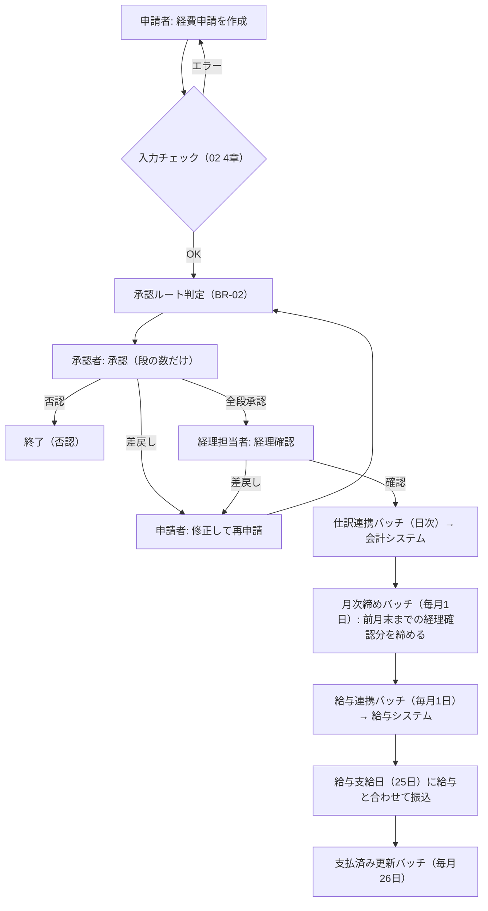

# 経費精算システム 基本設計書 01 システム概要

| 項目 | 内容 |
|---|---|
| 文書番号 | EXP-BD-01 |
| システム名 | 経費精算システム（システムコード: EXP） |
| 版数 | 1.3 |
| 作成部署 | インフォ商事株式会社 情報システム部 システム課 |
| 作成者 | 木村 |
| 承認者 | 井上（情報システム部長） |
| 最終更新日 | 2026-11-20 |

## 改訂履歴

| 版数 | 日付 | 改訂内容 | 作成者 | 承認者 |
|---|---|---|---|---|
| 1.0 | 2023-03-24 | 初版（2023-04-01 稼働） | 木村 | 井上 |
| 1.1 | 2023-09-15 | インボイス制度対応（登録番号・税区分の追加） | 木村 | 井上 |
| 1.2 | 2024-03-15 | 会議費の1人当たり上限を 5,000円から 10,000円に改定（2024-04-01 利用分から） | 林 | 井上 |
| 1.3 | 2026-11-20 | 業務日付設定・データ初期化・バッチ手動実行の追加。文書構成を 01〜06 に再編 | 木村 | 井上 |

## 基本設計書の構成

| 文書番号 | ファイル | 内容 |
|---|---|---|
| EXP-BD-01 | 01-overview.md | 目的・範囲・利用者・システム構成・周辺システム・業務フロー（本書） |
| EXP-BD-02 | 02-functions-screens.md | 機能一覧・画面一覧・画面遷移・画面項目・入力チェック・メッセージ・権限 |
| EXP-BD-03 | 03-data.md | ER図・テーブル定義・コード定義・初期データ |
| EXP-BD-04 | 04-business-rules.md | 業務ルール（承認ルート・領収書・運賃控除・日当・期限・税区分・締め） |
| EXP-BD-05 | 05-batch-interface.md | バッチ・外部連携ファイルのレイアウト |
| EXP-BD-06 | 06-architecture.md | 技術構成・フォルダ構成・層の分け方・命名規約・共通部品 |

規程の数値（領収書が必須になる金額、承認段数が変わる金額、日当の額など）は 04 にまとめ、02・05 からは業務ルールID（BR-xx）で参照する。

## 1. 目的

社員が立て替えた業務上の経費を、社内の経費規程に沿って申請・承認・確認し、給与と合わせて支払うまでを1つのシステムで扱う。

| 課題（導入前） | 本システムでの対応 |
|---|---|
| 紙の申請書と押印で、承認に日数がかかる | 申請・承認・経理確認を画面で行う |
| 承認者を申請者が自分で選び、規程上必要な承認が抜ける | 金額・経費種別・勘定科目から承認ルートを自動で決める（BR-02） |
| 通勤定期区間の控除漏れ、日当の計算誤り | 運賃・控除額・日当・宿泊費上限をシステムが計算する（BR-05、BR-06） |
| 領収書の添付漏れ、インボイスの登録番号確認の手間 | 領収書の要否・税区分をシステムが判定する（BR-04、BR-08） |
| 会計システムへの手入力 | 仕訳を夜間バッチでファイル連携する（05） |

## 2. 対象範囲

| 区分 | 対象 | 対象外 |
|---|---|---|
| 経費種別 | 交通費（近距離の外出）、出張旅費（国内）、一般経費 | 海外出張、仮払金（前払い）、法人カード利用分 |
| 業務 | 申請、承認、差戻し、否認、取下げ、経理確認、月次締め、給与連携、仕訳連携 | 予算管理、購買申請、固定資産の計上 |
| 利用者管理 | 人事システムから取り込んだ社員・組織に、経理担当者・システム管理者のロールを付与 | 社内認証基盤との連携（本版は画面上部の利用者切替で操作者を選ぶ） |
| 通知 | 画面上の件数表示（ホーム） | メール通知 |
| 証憑 | 添付ファイル名・種類の記録 | 添付ファイル実体の保存、領収書原本の保管管理 |

## 3. 利用者

| 利用者区分 | 該当者 | 主な操作 | 判定方法 |
|---|---|---|---|
| 申請者 | 在籍する全社員 | 経費の申請・再申請・取下げ | 社員マスタの在籍区分が「在籍」 |
| 承認者 | 課長・部長・本部長（組織長）、管理本部長 | 承認・差戻し・否認 | 承認経路の該当段に本人が設定されていること（BR-02） |
| 経理担当者 | 経理課の担当者 | 経理確認・経理差戻し・税区分の修正・個別支払済み登録 | 利用者ロールに ACCT を持つ |
| システム管理者 | システム課の担当者 | マスタ保守・バッチ実行・業務日付設定・データ初期化・承認者変更 | 利用者ロールに ADMIN を持つ |

1人が複数の区分を兼ねる（例: 課長は申請者かつ承認者）。

## 4. システム構成

- 本システムは端末のブラウザ内だけで動作し、サーバーを持たない。詳細は 06 を参照。
- 周辺システムとの連携はファイルで行う。本版では、取込ファイルはバッチ実行画面で選択し、出力ファイルはダウンロードで受け取る（05）。

## 5. 周辺システム

| システム | 管理部署 | 連携の向き | 連携内容 | 頻度 | 詳細 |
|---|---|---|---|---|---|
| 人事システム | 人事部 | 人事 → 本システム | 組織、社員、所属・役職の発令履歴、通勤経路（定期区間） | 日次 | 05 IF-01〜IF-04 |
| 会計システム | 経理部 | 本システム → 会計 | 経理確認済みの申請の仕訳（借方: 経費科目、貸方: 未払金） | 日次 | 05 IF-11 |
| 給与システム | 人事部 | 本システム → 給与 | 社員ごとの立替経費精算額（非課税支給） | 月次 | 05 IF-21 |

- 支払は給与と合わせて給与口座へ振り込む。本システムは口座情報を持たない。
- 消費税の仕入税額控除の計算は会計システムで行う。本システムは明細ごとの税区分と消費税額を連携する（BR-08）。

## 6. 業務フロー

### 6.1 申請から支払まで

### 6.2 業務カレンダー（例: 2026年11月に経理確認した申請）

| 日付 | 処理 | 担当 |
|---|---|---|
| 2026-11-30 まで | 申請・承認・経理確認 | 申請者・承認者・経理担当者 |
| 経理確認日の 22:00 | 仕訳連携（B02） | 自動 |
| 2026-12-01 01:00 | 月次締め（B03）: 11月末までの経理確認分を「支給年月 2026-12」で締める | 自動 |
| 2026-12-01 02:00 | 給与連携（B04） | 自動 |
| 2026-12-25 | 給与と合わせて振込（給与システム） | 人事部 |
| 2026-12-26 01:00 | 支払済み更新（B05） | 自動 |

### 6.3 利用者ごとの1日の流れ

| 利用者 | 主に使う画面 |
|---|---|
| 申請者 | SCR-02 申請一覧 → SCR-03 申請入力 → SCR-04 申請詳細 |
| 承認者 | SCR-01 ホーム（承認待ち件数）→ SCR-05 承認待ち一覧 → SCR-04 申請詳細 |
| 経理担当者 | SCR-06 経理確認一覧 → SCR-04 申請詳細 |
| システム管理者 | SCR-07 マスタ保守、SCR-08 バッチ実行、SCR-09 システム管理 |

## 7. 用語

| 用語 | 意味 |
|---|---|
| 申請 | 1件の経費精算の単位。経費種別（交通費・出張旅費・一般経費）を1つ持ち、明細を1件以上持つ |
| 明細 | 1回の支払・移動の単位。明細区分（鉄道・宿泊・日当など）で入力項目が変わる |
| 精算額 | 会社が申請者に支払う額。運賃控除・宿泊費上限を反映した後の額 |
| 承認段 | 承認の階層。段1=課長、段2=部長、段3=本部長 |
| 承認ルート | 申請ごとに決まる承認者の並び。申請時に確定する |
| 申請回次 | 差戻し後に再申請するたびに 1 増える番号 |
| 業務日付 | システムが「今日」として扱う日付。システム管理者が設定する（未設定時は端末の日付） |
| 基準日 | 期間つきの規程値（設定値・承認ルート規則・日当基準など）を引くときに使う日付。ルールごとに決まっている（BR-01） |
| 締め | 経理確認済みの申請を月単位で確定し、支給年月を決めること |
| 支給年月 | その申請を給与と合わせて支払う年月 |
| 甲地・乙地 | 宿泊費の上限を決める地域区分。甲地=東京都特別区・政令指定都市、乙地=それ以外 |
