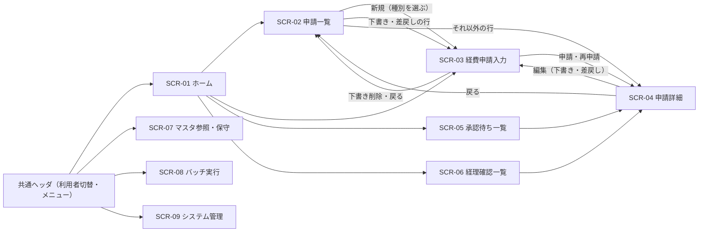

# 経費精算システム 基本設計書 02 機能・画面設計

| 項目 | 内容 |
|---|---|
| 文書番号 | EXP-BD-02 |
| 版数 | 1.3 |
| 作成部署 | インフォ商事株式会社 情報システム部 システム課 |
| 作成者 | 木村 |
| 承認者 | 井上（情報システム部長） |
| 最終更新日 | 2026-11-20 |

## 改訂履歴

| 版数 | 日付 | 改訂内容 | 作成者 | 承認者 |
|---|---|---|---|---|
| 1.0 | 2023-03-24 | 初版 | 木村 | 井上 |
| 1.1 | 2023-09-15 | SCR-03・SCR-04 に登録番号・税区分を追加 | 木村 | 井上 |
| 1.2 | 2024-03-15 | メッセージ E-126 の上限額を設定値から表示するよう変更 | 林 | 井上 |
| 1.3 | 2026-11-20 | SCR-08 バッチ実行、SCR-09 システム管理を追加。利用者切替を共通ヘッダに追加 | 木村 | 井上 |

## 1. 機能一覧

| 機能ID | 機能名 | 概要 | 画面・バッチ | 業務ルール |
|---|---|---|---|---|
| F-01 | 利用者切替 | 操作する利用者を選ぶ | 共通ヘッダ | — |
| F-02 | ホーム表示 | 自分に関係する件数を表示する | SCR-01 | — |
| F-03 | 申請一覧 | 自分の申請を検索・表示する | SCR-02 | — |
| F-04 | 申請の作成・下書き保存 | 交通費・出張旅費・一般経費の申請を作り、下書き保存する | SCR-03 | BR-04〜BR-08、BR-11 |
| F-05 | 申請 | 入力チェックし、承認ルートを決めて申請する | SCR-03 | BR-02、BR-03、BR-09 |
| F-06 | 再申請 | 差戻しされた申請を修正して申請し直す | SCR-03 | BR-02、BR-03、BR-09 |
| F-07 | 取下げ | 承認中・差戻しの申請を取り下げる | SCR-04 | BR-09 |
| F-08 | 下書き削除 | 下書きを削除する | SCR-03 | — |
| F-09 | 申請詳細表示 | 申請・明細・承認経路を表示する | SCR-04 | — |
| F-10 | 承認 | 承認待ちの段を承認する | SCR-04 | BR-09 |
| F-11 | 差戻し | 承認者が申請を差し戻す | SCR-04 | BR-09 |
| F-12 | 否認 | 承認者が申請を否認する | SCR-04 | BR-09 |
| F-13 | 承認待ち一覧 | 自分が承認待ちの申請を表示する | SCR-05 | — |
| F-14 | 経理確認 | 勘定科目・税区分を確認・修正し、経理確認する | SCR-04 | BR-08、BR-09-4、BR-10 |
| F-15 | 経理差戻し | 経理担当者が申請を差し戻す | SCR-04 | BR-09 |
| F-16 | 経理確認一覧 | 経理確認の対象・状況を検索する | SCR-06 | — |
| F-17 | 個別支払済み登録 | 給与連携の対象外となった申請を支払済みにする | SCR-04 | BR-10 |
| F-18 | 承認者変更 | 承認待ち・待機の段の承認者を変える | SCR-04 | BR-02 |
| F-19 | マスタ参照・保守 | マスタを参照し、規程値などを更新する | SCR-07 | BR-01-4 |
| F-20 | バッチ実行 | B01〜B05 を手動で実行し、履歴を見る | SCR-08 | 05 |
| F-21 | 業務日付設定 | システムが「今日」として扱う日付を設定する | SCR-09 | BR-01-2 |
| F-22 | データ初期化 | DB を初期状態に戻す | SCR-09 | — |
| F-23 | DB ファイル出力 | DB を SQLite ファイルとしてダウンロードする | SCR-09 | — |

## 2. 画面一覧

| 画面ID | 画面名 | 利用者 | URL（ハッシュ） |
|---|---|---|---|
| SCR-01 | ホーム | 全員 | `#/home` |
| SCR-02 | 申請一覧 | 全員 | `#/reports` |
| SCR-03 | 経費申請入力 | 申請者 | `#/report/edit?type=TR`（新規）、`#/report/edit?id={report_id}`（編集） |
| SCR-04 | 申請詳細 | 申請者・承認者・経理担当者・システム管理者 | `#/report?id={report_id}` |
| SCR-05 | 承認待ち一覧 | 承認者 | `#/approvals` |
| SCR-06 | 経理確認一覧 | 経理担当者・システム管理者 | `#/accounting` |
| SCR-07 | マスタ参照・保守 | 経理担当者（参照）・システム管理者 | `#/masters` |
| SCR-08 | バッチ実行 | システム管理者 | `#/batches` |
| SCR-09 | システム管理 | システム管理者 | `#/system` |

権限のない利用者が URL を直接開いた場合は E-203 を表示し SCR-01 に移る。

## 3. 画面遷移図

SCR-04 の「戻る」は、遷移元の画面（SCR-02・SCR-05・SCR-06）に戻る。遷移元が分からない場合は SCR-02。

## 4. 共通仕様

### 4.1 共通ヘッダ

| No | 項目 | 種別 | 内容 |
|---|---|---|---|
| 1 | システム名 | 表示 | 「経費精算システム」 |
| 2 | 環境表示 | 表示 | 「研修・検証用環境：認証は行いません。画面上部で利用者を切り替えて操作します。」を常時表示（背景色を通常と変える） |
| 3 | 利用者切替 | プルダウン | 在籍区分=在籍 の社員。表示「社員番号 氏名（組織名・役職名）」、社員番号順。変更すると SCR-01 に移る |
| 4 | 業務日付 | 表示 | 「業務日付 YYYY-MM-DD」。設定値が空の場合は「（端末日付）」を付ける |
| 5 | メニュー | リンク | 下表のうち利用者が使えるものだけ表示 |

| メニュー | 表示する利用者 |
|---|---|
| ホーム、申請一覧、承認待ち一覧（件数つき） | 全員 |
| 経理確認一覧 | ACCT または ADMIN |
| マスタ | ACCT または ADMIN |
| バッチ実行、システム管理 | ADMIN |

- 利用者の初期値は、前回選んだ利用者（localStorage `info-expense:current-user`）。保存がない、または在籍でない場合は社員番号が最小の在籍者。

### 4.2 表示・入力の共通ルール

| 項目 | ルール |
|---|---|
| 金額の表示 | 3桁カンマ区切り、右寄せ、単位「円」は列見出しに書く |
| 金額・数値の入力 | 半角数字のみ（カンマ・全角・小数・符号は不可）。違反は E-103 |
| 日付の入力 | `<input type="date">`。未入力・不正は E-101／E-104 |
| 文字の入力 | 前後の空白を除いてから桁・必須をチェックする。桁は文字数で数える |
| コードの表示 | m_code の名称で表示する |
| 入力チェックの時点 | ボタン押下時にまとめてチェックし、全エラーを画面上部のメッセージ欄に一覧表示する。該当項目の枠を赤くする |
| 確認ダイアログ | 更新を伴うボタンは確認メッセージ（C-xxx）を出し、「OK」で実行する |
| 完了メッセージ | 処理後、画面上部に I-xxx を表示する |
| 状態の再確認 | 更新処理の直前に DB 上の状態を読み直し、画面表示時から変わっていれば E-202 を出して中止する |
| 一覧の件数 | 一覧は最大 200 件表示。超える場合は「検索条件を絞ってください（200件まで表示）」を一覧の上に表示 |

## 5. 画面定義

### 5.1 SCR-01 ホーム

| No | 項目 | 種別 | 表示条件 | 内容 |
|---|---|---|---|---|
| 1 | 新規申請ボタン（交通費／出張旅費／一般経費） | ボタン | 全員 | SCR-03 を新規で開く（`type=TR／BT／GE`） |
| 2 | 下書き件数 | リンク | 全員 | 自分の状態 10 の件数。SCR-02（状態=下書き）へ |
| 3 | 差戻し件数 | リンク | 全員 | 自分の状態 30 の件数。SCR-02（状態=差戻し）へ |
| 4 | 承認中件数 | リンク | 全員 | 自分の状態 20 の件数。SCR-02（状態=承認中）へ |
| 5 | 承認待ち件数 | リンク | 全員 | 自分が approver_id で step_status=CUR の段の件数。SCR-05 へ |
| 6 | 経理確認待ち件数 | リンク | ACCT | 状態 40 の件数（自分の申請を含む）。SCR-06 へ |

### 5.2 SCR-02 申請一覧

検索条件:

| No | 項目 | 種別 | 初期値 | 条件 |
|---|---|---|---|---|
| 1 | 状態 | プルダウン | すべて | 「すべて」または REPORT_STATUS の1つ |
| 2 | 経費種別 | プルダウン | すべて | 「すべて」または EXPENSE_TYPE の1つ |
| 3 | 申請日（から・まで） | 日付 | 空 | submitted_at の日付部分で範囲検索。下書きは申請日がないため、指定時は対象外 |
| 4 | 件名 | テキスト | 空 | 部分一致 |

一覧（申請者 = ログイン利用者 のみ。更新日時の降順）:

| No | 列 | 内容 |
|---|---|---|
| 1 | 申請番号 | リンク。状態 10・30 は SCR-03、それ以外は SCR-04 |
| 2 | 経費種別 | |
| 3 | 件名 | |
| 4 | 合計金額 | |
| 5 | 状態 | 遅延申請は「（遅延）」を付ける |
| 6 | 申請日 | submitted_at の日付部分 |
| 7 | 更新日時 | |

ボタン: 「検索」「条件クリア」「交通費を申請」「出張旅費を申請」「一般経費を申請」

### 5.3 SCR-03 経費申請入力

#### 5.3.1 開き方と表示モード

| 開き方 | 条件 | モード |
|---|---|---|
| `type=TR／BT／GE` | — | 新規 |
| `id=` で状態 10 | 申請者 = ログイン利用者 | 編集 |
| `id=` で状態 30 | 申請者 = ログイン利用者 | 再申請 |
| `id=` でそれ以外 | — | SCR-04 に移る |
| 申請者 ≠ ログイン利用者 | — | E-203 を出して SCR-01 に移る |

#### 5.3.2 ヘッダ部（全種別）

| No | 項目 | 種別 | 必須 | 桁・形式 | 初期値 | 内容 |
|---|---|---|---|---|---|---|
| 1 | 申請番号 | 表示 | — | — | 新規は「（保存時に採番）」 | |
| 2 | 経費種別 | 表示 | — | — | URL の type | 変更不可 |
| 3 | 申請者 | 表示 | — | — | ログイン利用者 | 「社員番号 氏名」 |
| 4 | 所属 | 表示 | — | — | 申請者の現在の所属 | |
| 5 | 状態 | 表示 | — | — | 新規は「下書き」 | 再申請モードは前回の差戻しコメント（段・処理者・日時・コメント）も表示 |
| 6 | 件名 | テキスト | ○ | 40文字 | 空 | |
| 7 | 申請理由・備考 | テキストエリア | | 200文字 | 空 | |
| 8 | 申請期限 | 表示 | — | — | — | BR-03 で計算。起算日が決まらない（明細なし）場合は「—」 |
| 9 | 遅延理由 | テキストエリア | 遅延時 ○ | 200文字 | 空 | 遅延申請（BR-03）のときだけ表示し、W-101 を表示 |
| 10 | 通勤定期区間 | 表示 | — | — | — | 交通費・出張旅費のみ。業務日付で有効な区間「路線 駅〜駅（有効期間）」。ない場合は「登録なし」。注記「控除は明細の利用日時点の区間で計算します」 |

#### 5.3.3 出張情報部（出張旅費のみ）

| No | 項目 | 種別 | 必須 | 桁・形式 | 初期値 | 内容 |
|---|---|---|---|---|---|---|
| 1 | 出張先 | テキスト | ○ | 40文字 | 空 | |
| 2 | 出発日 | 日付 | ○ | — | 空 | |
| 3 | 帰着日 | 日付 | ○ | — | 空 | |
| 4 | 出張区分 | ラジオ | ○ | DAY／STAY | 宿泊 | |
| 5 | 片道距離（km） | 数値 | 日帰り時 ○ | 1〜9999 | 空 | 日帰りのときだけ表示 |
| 6 | 日当算定役職 | 表示 | — | — | — | BR-06-2。出発日を入力すると表示 |

#### 5.3.4 明細部

明細の追加ボタン（経費種別ごと）:

| 経費種別 | 追加ボタン |
|---|---|
| 交通費 | 「鉄道（運賃算定）」「鉄道・バス（手入力）」「タクシー」 |
| 出張旅費 | 「鉄道（運賃算定）」「鉄道・バス（手入力）」「タクシー」「航空」「宿泊」。日当明細は出発日・帰着日・出張区分が揃った時点で自動で1行作る（追加ボタンなし） |
| 一般経費 | 「明細を追加」 |

- 各行に「削除」ボタン（日当明細を除く）。明細は最大 50 行。
- 日当明細は常に明細の最後の行に置く。
- 明細番号は画面上の並び順で 1 から振る。メッセージの「明細{n}」はこの番号。

明細の項目（区分ごと。○=必須、△=条件つき必須、空欄=任意、—=表示のみ）:

| 項目 | 種別 | 桁・形式 | 初期値 | RAIL | PUBT | TAXI | AIR | HOTEL | ALLOW | GEN |
|---|---|---|---|---|---|---|---|---|---|---|
| 明細区分 | 表示 | — | 追加時の区分 | — | — | — | — | — | — | — |
| 利用日（宿泊は宿泊日） | 日付 | — | 空（出張は出発日） | ○ | ○ | ○ | ○ | ○ | —（出発日） | ○ |
| 用務・内容 | テキスト | 100文字 | 空 | ○ 訪問先と目的 | ○ | ○ | ○ | ○ 宿泊先 | —「日当」 | ○ 品名・内容 |
| 路線 | プルダウン | LINE | 未選択 | ○ | | | | | | |
| 乗車駅・降車駅 | プルダウン | 選んだ路線の駅（駅順） | 未選択 | ○ | | | | | | |
| 経路 | テキスト | 100文字 | 空 | | ○ 例「A駅→B駅（特急）」 | ○ | ○ | | | |
| 片道・往復 | ラジオ | 1／2 | 往復 | ○ | ○ | | | | | |
| 片道運賃 | 数値 | 1〜999,999 | 空 | | ○ | | | | | |
| 運賃・控除額 | 表示 | — | — | —（片道の運賃と控除額） | | | | | | |
| 地域区分 | ラジオ | A／B | 未選択 | | | | | ○ | | |
| 実費 | 数値 | 1〜999,999 | 空 | | | | | ○ | | |
| 上限額・自己負担額 | 表示 | — | — | | | | | — | | |
| 日数・日当単価 | 表示 | — | — | | | | | | — | |
| 勘定科目 | プルダウン | general_selectable=1 の科目（表示順） | 未選択 | | | | | | | ○ |
| 支払先 | テキスト | 40文字 | 空 | | | | | | | ○ |
| 税率 | プルダウン | TAX_RATE | 科目の既定の税率 | | | | | | | ○ |
| 金額（税込） | 数値 | 1〜9,999,999 | 空 | | | ○ | ○ | | | ○ |
| 消費税額 | 数値 | 0〜9,999,999 | 空（未入力なら自動計算） | | | | | | | 空欄可 |
| 登録番号 | テキスト | `T`＋数字13桁 | 空 | | 空欄可 | 空欄可 | 空欄可 | 空欄可 | | 空欄可 |
| 飲食を伴う | チェック | — | オフ | | | | | | | 科目の会議費上限判定=1 のときだけ表示 |
| 参加人数 | 数値 | 1〜999 | 空 | | | | | | | △ 科目の参加者記入必須=1 |
| 参加者 | テキストエリア | 200文字 | 空 | | | | | | | △ 同上 |
| 支払方法 | プルダウン | PAY_METHOD | RAIL・PUBT は IC、他は CASH | ○ | ○ | ○ | ○ | ○ | | ○ |
| 領収書区分 | プルダウン | RECEIPT_KIND | 添付なし | ○ | ○ | ○ | ○ | ○ | 表示しない | ○ |
| 添付ファイル | ファイル | .pdf .jpg .jpeg .png | — | △ 領収書区分が添付なし以外 | △ | △ | △ | △ | | △ |
| 領収書要否 | 表示 | — | — | BR-04 の判定を「必須」「任意」「不要」で表示 | | | | | | |
| 税区分 | 表示 | — | — | BR-08 の判定を名称で表示 | | | | | | |
| 精算額 | 表示 | — | — | BR-05 | 片道運賃×片道往復 | 金額 | 金額 | BR-06-3 | BR-06-2 | 金額 |

- 領収書区分の選択肢: IC利用履歴 は PUBT 以外の明細では表示しない。
- 添付ファイルはファイル名だけを記録する。編集時は記録済みのファイル名を表示し、選び直さなくてよい。

#### 5.3.5 再計算

明細・出張情報のいずれかの項目を変更した時点で、次を計算し直して表示する（保存はしない）。

| 計算 | ルール |
|---|---|
| 運賃・控除額・精算額（RAIL） | BR-05。全区間定期区間内の場合は精算額 0 と表示し、行に E-113 の文言を表示 |
| 上限額・精算額・自己負担額（HOTEL） | BR-06-3。超過時は W-102 |
| 日当明細（ALLOW） | BR-06-2。出発日・帰着日・出張区分のどれかが未入力なら日当明細を削除 |
| 領収書要否・税区分・消費税額 | BR-04、BR-08。税区分が BR-08-2 の順5・順6（N10・N08・Z10・Z08）になった明細には W-103 |
| 合計金額 | BR-01-1 |
| 申請期限・遅延表示 | BR-03 |
| 承認ルート（予定） | BR-02。申請日=業務日付として判定し「鈴木（課長承認）→ 高橋（部長承認）→ 経理確認」の形で表示。決定できない場合は E-129 の文言 |

#### 5.3.6 集計部・ボタン

| No | 項目 | 種別 | 表示条件 | 内容 |
|---|---|---|---|---|
| 1 | 合計金額 | 表示 | 常に | |
| 2 | 承認ルート（予定） | 表示 | 常に | 5.3.5 |
| 3 | 下書き保存 | ボタン | 新規・編集 | 下書き保存時のチェック（5.3.7）→ 保存（状態 10）→ I-001。新規は BR-11 で採番 |
| 4 | 申請 | ボタン | 新規・編集 | C-001 → 申請時のチェック → 保存 → BR-09-3「申請」→ I-002 → SCR-04 |
| 5 | 再申請 | ボタン | 再申請 | C-001 → 申請時のチェック → 保存 → BR-09-3「再申請」→ I-003 → SCR-04 |
| 6 | 下書き削除 | ボタン | 編集（保存済みの下書き） | C-003 → 申請・明細を物理削除 → I-005 → SCR-02 |
| 7 | 戻る | ボタン | 常に | 未保存の変更があれば C-010 → SCR-02 |

再申請モードでは「下書き保存」で状態 30 のまま内容を保存できる（I-001）。

#### 5.3.7 入力チェック

「時点」: 保=下書き保存時、申=申請・再申請時。チェックは上から順に全件行い、エラーをまとめて表示する。

| No | 対象 | 条件（エラーになる場合） | メッセージ | 時点 |
|---|---|---|---|---|
| CHK-01 | 件名 | 未入力 | E-101 | 保・申 |
| CHK-02 | 文字項目すべて | 桁超過 | E-102 | 保・申 |
| CHK-03 | 数値項目すべて | 入力があり、半角数字でない、または範囲外 | E-103 | 保・申 |
| CHK-04 | 日付項目すべて | 入力があり、日付として不正 | E-104 | 保・申 |
| CHK-05 | 出張先・出発日・帰着日・出張区分 | 未入力（出張旅費） | E-101／E-105 | 申 |
| CHK-06 | 片道距離 | 日帰りで未入力 | E-101 | 申 |
| CHK-07 | 出発日・帰着日 | 業務日付より後 | E-121 | 申 |
| CHK-08 | 帰着日 | 出発日より前 | E-114 | 申 |
| CHK-09 | 出張区分＝宿泊 | 帰着日 = 出発日 | E-115 | 申 |
| CHK-10 | 出張区分＝日帰り | 帰着日 ≠ 出発日 | E-116 | 申 |
| CHK-11 | 片道距離 | 日帰りで `DAY_TRIP_MIN_KM` 未満 | E-117 | 申 |
| CHK-12 | 出張日数 | 31日を超える | E-136 | 申 |
| CHK-13 | 日当算定役職 | 出発日時点の所属・役職履歴がない | E-137 | 申 |
| CHK-14 | 明細 | 0件（出張旅費は日当明細以外が0件でもよい） | E-110 | 申 |
| CHK-15 | 明細の必須項目 | 5.3.4 の必須・条件つき必須が未入力 | E-101／E-105 | 申 |
| CHK-16 | 利用日 | 業務日付より後 | E-111 | 申 |
| CHK-17 | 利用日（出張旅費） | 出発日〜帰着日の範囲外 | E-118 | 申 |
| CHK-18 | 宿泊明細 | 出張区分が日帰り | E-138 | 申 |
| CHK-19 | 宿泊日 | 出発日 ≦ 宿泊日 ＜ 帰着日 でない | E-119 | 申 |
| CHK-20 | 宿泊日 | 同じ宿泊日の宿泊明細が2件以上 | E-120 | 申 |
| CHK-21 | 乗車駅・降車駅 | 同じ駅 | E-112 | 申 |
| CHK-22 | RAIL の運賃 | 運賃マスタに該当行がない | E-131 | 申 |
| CHK-23 | RAIL の定期控除 | 全区間が定期区間内 | E-113 | 申 |
| CHK-24 | 消費税額 | 精算額を超える | E-127 | 申 |
| CHK-25 | 登録番号 | 入力があり、`^T[0-9]{13}$` に合わない | E-125 | 保・申 |
| CHK-26 | 会議費 | BR-07-2 の上限超過 | E-126 | 申 |
| CHK-27 | 領収書区分 | 要否が必須で「添付なし」 | E-122 | 申 |
| CHK-28 | 領収書区分 | 「IC利用履歴」で、PUBT かつ支払方法 IC でない | E-123 | 申 |
| CHK-29 | 添付ファイル | 領収書区分が添付なし以外で、ファイル名がない | E-124 | 申 |
| CHK-30 | 添付ファイル | 拡張子が pdf・jpg・jpeg・png 以外 | E-128 | 保・申 |
| CHK-31 | 遅延理由 | 遅延申請で未入力 | E-130 | 申 |
| CHK-32 | 承認ルート | BR-02 で決定できない | E-129 | 申 |

CHK-32 は CHK-01〜CHK-31 にエラーがない場合だけ行う。

### 5.4 SCR-04 申請詳細

#### 5.4.1 表示できる利用者

申請者本人、その申請のいずれかの申請回次の承認経路に承認者として設定された者、ACCT、ADMIN。それ以外は E-203 を出して SCR-01 に移る。

#### 5.4.2 表示項目

| 区分 | 項目 |
|---|---|
| ヘッダ | 申請番号、経費種別、状態、申請者（社員番号・氏名）、申請時所属、件名、申請理由・備考、合計金額、必要段数、申請回次、初回申請日時、申請日時、遅延申請の有無・遅延理由、経理確認日時・経理確認者、支給年月、仕訳連携（済・未）、支払日時・支払方法 |
| 出張情報 | 出張先、出発日、帰着日、出張区分、片道距離、日当算定役職（出張旅費のみ） |
| 明細 | 明細番号、明細区分、利用日、用務・内容、区間または経路、片道・往復、運賃・控除額、勘定科目、支払先、税率、消費税額、登録番号、参加人数・参加者、支払方法、領収書区分・添付ファイル名、領収書要否、税区分、精算額 |
| 承認経路 | 申請回次ごとに、段順、段（課長承認／部長承認／本部長承認／最終承認／経理確認）、承認者、段状態、処理者、処理日時、コメント、承認者変更記録。最新の申請回次を上に表示 |

#### 5.4.3 操作

| 操作 | 表示条件 | 入力 | 処理 | メッセージ |
|---|---|---|---|---|
| 編集 | 申請者本人、状態 10・30 | — | SCR-03 へ | — |
| 取下げ | 申請者本人、状態 20・30 | — | BR-09-3 | C-002、I-004 |
| 承認 | ログイン利用者が step_status=CUR の承認段の approver_id | コメント（任意、200文字） | BR-09-3 | C-004、I-201 |
| 差戻し（承認者） | 同上 | コメント（必須、200文字） | BR-09-3 | C-005、E-201、I-202 |
| 否認 | 同上 | コメント（必須、200文字） | BR-09-3 | C-006、E-201、I-203 |
| 経理確認 | ACCT、状態 40 | 明細ごとの勘定科目（GEN のみ）・税区分（プルダウン）、コメント（任意） | E-305・E-303・E-304 をチェックし、明細の変更を保存して BR-09-3 | C-007、I-301 |
| 経理差戻し | ACCT、状態 40 | コメント（必須） | BR-09-3 差戻し（経理確認の段を BACK） | C-005、E-201、I-202 |
| 個別支払済み登録 | ACCT、状態 60、payroll_run_id が NULL | — | 状態 70、paid_method=M、paid_at=処理日時 | C-011、I-302 |
| 承認者変更 | ADMIN、状態 20 | 対象の段（step_status が CUR または WAIT の承認段）、変更後の社員番号、変更理由（必須、100文字） | 5.4.4 | E-206〜E-208、I-204 |
| 戻る | 常に | — | 遷移元へ | — |

- 承認者が同時に経理担当者の場合も、承認と経理確認はそれぞれの条件で表示する。
- 経理確認で勘定科目を変えた場合、税率・税区分は経理担当者が選んだ値をそのまま保存する（自動判定し直さない）。

#### 5.4.4 承認者変更のチェックと処理

| No | 条件（エラー） | メッセージ |
|---|---|---|
| 1 | 変更後の社員が存在しない、または在籍区分が退職 | E-206 |
| 2 | 変更後の社員が申請者本人 | E-207 |
| 3 | 変更後の社員の役職コードが、段の役職の下限（BR-02-1）未満 | E-208 |
| 4 | 変更理由が未入力 | E-101 |

処理: approver_id を変更し、changed_note に「{変更前社員番号}→{変更後社員番号} {処理日時} {変更者社員番号} {変更理由}」を追記する（既存の内容がある場合は改行して追記）。

### 5.5 SCR-05 承認待ち一覧

対象: t_approval_step で approver_id = ログイン利用者 かつ step_status = CUR。申請日時の昇順。

| No | 列 | 内容 |
|---|---|---|
| 1 | 申請番号 | リンク（SCR-04） |
| 2 | 申請日時 | |
| 3 | 申請者 | 社員番号・氏名 |
| 4 | 経費種別 | |
| 5 | 件名 | |
| 6 | 合計金額 | |
| 7 | 段 | 課長承認／部長承認／本部長承認／最終承認 |
| 8 | 遅延 | 遅延申請なら「遅延」 |
| 9 | 申請回次 | 2 以上なら「再申請」と表示 |

### 5.6 SCR-06 経理確認一覧

検索条件:

| No | 項目 | 種別 | 初期値 | 条件 |
|---|---|---|---|---|
| 1 | 状態 | プルダウン | 経理確認待ち（40） | 「すべて」または 40・50・60・70・30 |
| 2 | 経費種別 | プルダウン | すべて | |
| 3 | 申請者 | テキスト | 空 | 社員番号の前方一致、または氏名の部分一致 |
| 4 | 経理確認日（から・まで） | 日付 | 空 | accounting_checked_at の日付部分 |
| 5 | 支給年月 | テキスト | 空 | `YYYY-MM` の完全一致 |
| 6 | 仕訳連携 | プルダウン | すべて | すべて／済／未 |

一覧（申請日時の昇順）: 申請番号（リンク）、状態、申請者、申請時所属、経費種別、件名、合計金額、申請日時、経理確認日時、仕訳連携（済・未）、支給年月。

### 5.7 SCR-07 マスタ参照・保守

| タブ | テーブル | ACCT | ADMIN | 更新の方法 |
|---|---|---|---|---|
| 承認ルート規則 | m_approval_rule | 参照 | 更新 | 新しい期間の追加（経費種別単位で金額範囲の行をまとめて登録） |
| 日当・宿泊費基準 | m_travel_rate | 参照 | 更新 | 新しい期間の追加（役職単位） |
| 設定値 | m_setting | 参照 | 更新 | 新しい期間の追加（OPERATION_DATE を除く。OPERATION_DATE は SCR-09） |
| 運賃 | m_fare | 参照 | 更新 | 新しい期間の追加（路線単位で行をまとめて登録） |
| 勘定科目 | m_account_title | 参照 | 更新 | 行の追加・変更 |
| 駅 | m_station | 参照 | 更新 | 行の追加・変更 |
| ロール | m_user_role | 参照 | 更新 | 行の追加・削除 |
| 組織・社員・所属役職履歴・通勤定期区間 | 人事由来 | 参照 | 参照 | B01 のみ |
| コード | m_code | 参照 | 参照 | 初期データのみ |

期間つきマスタの更新ルール:

| No | ルール | メッセージ |
|---|---|---|
| 1 | 追加する行の有効開始日は業務日付の翌日以降 | E-501 |
| 2 | 同じキー・同じ有効開始日の行は追加できない | E-502 |
| 3 | 追加すると、同じキーで直前の期間の行の有効終了日を「新しい有効開始日の前日」に更新する | — |
| 4 | 有効開始日が業務日付より後の行は削除できる。削除すると直前の期間の行の有効終了日を NULL に戻す | — |
| 5 | 承認ルート規則は 4.9（03）の金額範囲の条件を満たす | E-503 |

その他の更新ルール: 勘定科目・駅は、明細・定期区間から参照されている行は削除できない（E-504。削除ボタンは表示するが実行時にチェック）。

### 5.8 SCR-08 バッチ実行

| No | バッチ | 入力 | 初期値 | 実行時の処理 |
|---|---|---|---|---|
| 1 | B01 人事マスタ取込 | ファイル4つ（組織・社員・発令・通勤経路） | — | C-008 → 05 B01 → 結果表示 |
| 2 | B02 仕訳連携 | なし | — | C-008 → 05 B02 → 出力ファイルをダウンロード |
| 3 | B03 月次締め | 対象年月（`YYYY-MM`） | 業務日付の前月 | C-008 → 05 B03 |
| 4 | B04 給与連携 | 支給年月（`YYYY-MM`） | 業務日付の月 | C-008 → 05 B04 → 出力ファイルをダウンロード |
| 5 | B05 支払済み更新 | 支給年月（`YYYY-MM`） | 業務日付の月 | C-008 → 05 B05 |

- 実行結果欄: 結果（正常・警告あり・異常）、件数、金額合計、ファイル名、メッセージ（I-401、W-4xx、E-4xx）。
- 実行履歴: t_batch_run を実行IDの降順で最大 50 件。列は実行ID、バッチ、業務日付、パラメータ、開始日時、終了日時、結果、件数、金額合計、ファイル名、メッセージ、実行者。
- 出力ファイルは実行したときにだけダウンロードする（再ダウンロード機能はない）。

### 5.9 SCR-09 システム管理

| No | 項目 | 種別 | 内容 |
|---|---|---|---|
| 1 | 業務日付 | 日付＋「設定」ボタン | m_setting の OPERATION_DATE を更新（空にすると端末日付）。I-901 |
| 2 | データ初期化 | ボタン | C-009 → localStorage の `info-expense:` で始まるキーをすべて削除 → DDL と初期データで DB を作り直す → I-902 → SCR-01 |
| 3 | DB ファイル出力 | ボタン | DB を `info-expense-YYYYMMDD.sqlite`（YYYYMMDD=業務日付）としてダウンロード |
| 4 | 保存サイズ | 表示 | localStorage に保存している DB の文字数（KB 単位） |
| 5 | スキーマ版数 | 表示 | 06 の SCHEMA_VERSION |

## 6. メッセージ一覧

`{0}` `{1}` は差し込み。種別 I=完了、W=警告（処理は続く）、E=エラー（処理を中止）、C=確認。

| ID | 本文 |
|---|---|
| I-001 | 保存しました。 |
| I-002 | 申請しました。申請番号: {0} |
| I-003 | 再申請しました。 |
| I-004 | 取下げました。 |
| I-005 | 削除しました。 |
| I-201 | 承認しました。 |
| I-202 | 差戻しました。 |
| I-203 | 否認しました。 |
| I-204 | 承認者を変更しました。 |
| I-301 | 経理確認しました。 |
| I-302 | 個別支払済みとして登録しました。 |
| I-401 | {0}が正常に終了しました。（件数: {1}） |
| I-901 | 業務日付を {0} に設定しました。 |
| I-902 | データを初期状態に戻しました。 |
| W-101 | 申請期限（{0}）を過ぎています。遅延理由を入力してください。承認は部長承認以上が必要になります。 |
| W-102 | 明細{0}: 宿泊費の実費が上限額 {1}円 を超えています。超過分 {2}円 は自己負担になります。 |
| W-103 | 明細{0}: 登録番号が未入力のため、税区分は「{1}」になります。 |
| W-401 | 対象データが0件でした。（ヘッダとトレーラのみのファイルを出力しました） |
| W-402 | 承認待ち・待機中の段に、退職者または組織長でなくなった承認者がいる申請が {0} 件あります。承認者変更をしてください。（{1}） |
| W-403 | 退職者の精算 {0} 件（{1}）は給与連携の対象外です。個別に振り込んでください。 |
| E-101 | {0}を入力してください。 |
| E-102 | {0}は{1}文字以内で入力してください。 |
| E-103 | {0}は{1}〜{2}の半角数字で入力してください。 |
| E-104 | {0}は正しい日付で入力してください。 |
| E-105 | {0}を選択してください。 |
| E-110 | 明細を1件以上入力してください。 |
| E-111 | 明細{0}: 利用日に業務日付（{1}）より後の日付は指定できません。 |
| E-112 | 明細{0}: 乗車駅と降車駅に同じ駅は指定できません。 |
| E-113 | 明細{0}: 乗車区間がすべて通勤定期区間内のため申請できません。 |
| E-114 | 帰着日は出発日以降の日付を入力してください。 |
| E-115 | 宿泊出張の帰着日は出発日の翌日以降にしてください。 |
| E-116 | 日帰り出張の帰着日は出発日と同じ日にしてください。 |
| E-117 | 日帰り出張は片道{0}km以上の場合に限ります。{0}km未満の移動は交通費で申請してください。 |
| E-118 | 明細{0}: 利用日は出張期間（{1}〜{2}）内の日付にしてください。 |
| E-119 | 明細{0}: 宿泊日は出発日から帰着日の前日までの日付にしてください。 |
| E-120 | 明細{0}: 宿泊日 {1} の宿泊明細が重複しています。 |
| E-121 | 出発日・帰着日に業務日付（{0}）より後の日付は指定できません。 |
| E-122 | 明細{0}: 領収書の添付が必要です。 |
| E-123 | 明細{0}: IC利用履歴で代替できるのは、ICカードで支払った鉄道・バス（手入力）の明細だけです。 |
| E-124 | 明細{0}: 添付ファイルを選択してください。 |
| E-125 | 明細{0}: 登録番号は「T」と13桁の数字で入力してください。 |
| E-126 | 明細{0}: 飲食を伴う会議費は1人当たり{1}円以下です。超える場合は勘定科目を接待交際費にしてください。 |
| E-127 | 明細{0}: 消費税額は精算額以下で入力してください。 |
| E-128 | 明細{0}: 添付ファイルは PDF・JPEG・PNG のいずれかにしてください。 |
| E-129 | 承認者を決定できないため申請できません。システム管理者に連絡してください。 |
| E-130 | 申請期限（{0}）を過ぎています。遅延理由を入力してください。 |
| E-131 | 明細{0}: この区間の運賃を算定できません。鉄道・バス（手入力）の明細で申請してください。 |
| E-136 | 出張期間は31日以内にしてください。 |
| E-137 | 出発日時点の役職が見つかりません。システム管理者に連絡してください。 |
| E-138 | 明細{0}: 宿泊明細は宿泊出張の場合だけ入力できます。 |
| E-201 | コメントを入力してください。 |
| E-202 | この申請は他の操作で状態が変わっています。画面を開き直してください。 |
| E-203 | この操作を行う権限がありません。 |
| E-206 | 変更後の承認者には在籍している社員を指定してください。 |
| E-207 | 申請者本人を承認者にすることはできません。 |
| E-208 | 変更後の承認者の役職が、この段に必要な役職（{0}以上）に達していません。 |
| E-303 | 業務日付の月（{0}）は締め済みのため経理確認できません。 |
| E-304 | 明細{0}: 勘定科目の変更により必要な承認段数が{1}段になるため、変更できません。差戻してください。 |
| E-305 | 自分の申請は経理確認できません。 |
| E-401 | {0} {1}行目: {2} |
| E-402 | {0}が選択されていません。 |
| E-403 | {0} の月次締めは実行済みです。 |
| E-404 | 仕訳未連携の経理確認済み申請が {0} 件あります。先に仕訳連携（B02）を実行してください。 |
| E-405 | 支払済み更新は支給年月の26日以降に実行してください。 |
| E-406 | 支給年月 {0} の給与連携が実行されていません。先に給与連携（B04）を実行してください。 |
| E-407 | 対象年月 {0} の月次締めが実行されていません。先に月次締め（B03）を実行してください。 |
| E-408 | 支給年月 {0} の給与連携は実行済みです。 |
| E-409 | 対象年月 {0} が終わっていないため締められません（業務日付 {1}）。 |
| E-501 | 有効開始日は業務日付の翌日以降の日付にしてください。 |
| E-502 | 同じキーと有効開始日の行が既にあります。 |
| E-503 | 承認ルート規則の金額範囲は、0円から始まり隙間なく続け、最後の行の金額上限を空にしてください。 |
| E-504 | 使用中のため削除できません。 |
| E-901 | マスタ「{0}」に基準日 {1} で有効な行が{2}件あります。システム管理者に連絡してください。 |
| E-902 | データを保存できませんでした（ブラウザの保存容量の上限）。システム管理者に連絡してください。 |
| E-903 | データベースを読み込めませんでした。システム管理画面でデータ初期化を行ってください。 |
| C-001 | 申請します。よろしいですか。 |
| C-002 | 取下げます。よろしいですか。 |
| C-003 | 下書きを削除します。よろしいですか。 |
| C-004 | 承認します。よろしいですか。 |
| C-005 | 差戻します。よろしいですか。 |
| C-006 | 否認します。よろしいですか。 |
| C-007 | 経理確認します。よろしいですか。 |
| C-008 | {0}を実行します。よろしいですか。 |
| C-009 | すべてのデータを初期状態に戻します。この操作は取り消せません。よろしいですか。 |
| C-010 | 入力内容を破棄して戻ります。よろしいですか。 |
| C-011 | 個別支払済みとして登録します。よろしいですか。 |

E-101〜E-105 の `{0}` には画面の項目名を入れる。明細の項目は「明細{n}の{項目名}」とする。

## 7. 権限マトリクス

○=可、△=条件つき、－=不可。

| 機能 | 申請者（全社員） | 承認者 | 経理担当者（ACCT） | システム管理者（ADMIN） |
|---|---|---|---|---|
| F-01 利用者切替 | ○ | ○ | ○ | ○ |
| F-02 ホーム | ○ | ○ | ○ | ○ |
| F-03 申請一覧（自分の申請） | ○ | ○ | ○ | ○ |
| F-04〜F-06、F-08 作成・申請・再申請・下書き削除 | △ 自分の申請 | － | － | － |
| F-07 取下げ | △ 自分の申請 | － | － | － |
| F-09 申請詳細 | △ 自分の申請 | △ 自分が経路にある申請 | ○ | ○ |
| F-10〜F-12 承認・差戻し・否認 | － | △ 自分が承認待ちの段 | － | － |
| F-13 承認待ち一覧 | ○（0件） | ○ | ○ | ○ |
| F-14、F-15 経理確認・経理差戻し | － | － | △ 自分の申請以外 | － |
| F-16 経理確認一覧 | － | － | ○ | ○（参照のみ） |
| F-17 個別支払済み登録 | － | － | ○ | － |
| F-18 承認者変更 | － | － | － | ○ |
| F-19 マスタ | － | － | 参照 | ○ |
| F-20 バッチ実行 | － | － | － | ○ |
| F-21〜F-23 業務日付・初期化・DB出力 | － | － | － | ○ |

ACCT・ADMIN を持つ社員も、自分の経費は申請者として申請する。
