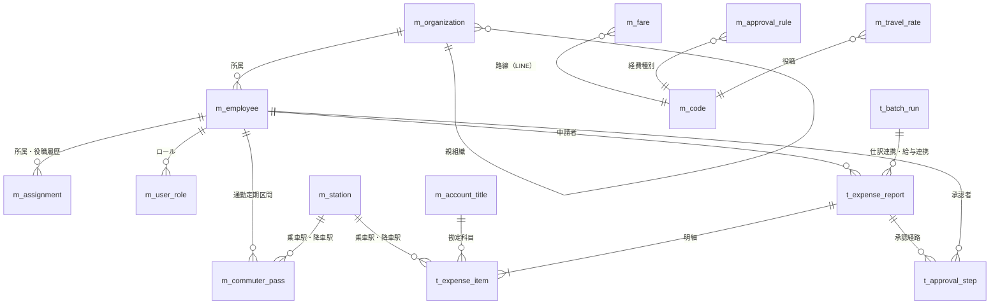

# 経費精算システム 基本設計書 03 データ設計

| 項目 | 内容 |
|---|---|
| 文書番号 | EXP-BD-03 |
| 版数 | 1.3 |
| 作成部署 | インフォ商事株式会社 情報システム部 システム課 |
| 作成者 | 木村 |
| 承認者 | 井上（情報システム部長） |
| 最終更新日 | 2026-11-20 |

## 改訂履歴

| 版数 | 日付 | 改訂内容 | 作成者 | 承認者 |
|---|---|---|---|---|
| 1.0 | 2023-03-24 | 初版 | 木村 | 井上 |
| 1.1 | 2023-09-15 | t_expense_item に登録番号・税区分・消費税額を追加。コード TAX_CATEGORY を追加 | 木村 | 井上 |
| 1.2 | 2024-03-15 | m_setting に MEAL_LIMIT_PER_PERSON の新しい期間の行を追加 | 林 | 井上 |
| 1.3 | 2026-11-20 | m_setting に OPERATION_DATE を追加。初期データの方針（8章）を追加 | 木村 | 井上 |

## 1. 方針

| 項目 | 方針 |
|---|---|
| DBMS | SQLite（sql.js 1.10.3）。外部キー制約を有効にする（`PRAGMA foreign_keys = ON`） |
| 型 | SQLite の型 TEXT・INTEGER のみ使う。REAL は使わない（金額・キロは整数） |
| 日付 | TEXT `YYYY-MM-DD`。日時は TEXT `YYYY-MM-DD HH:MM:SS`（業務日付＋端末時刻） |
| 真偽値 | INTEGER 0/1 |
| 桁 | TEXT は最大文字数、INTEGER は最大桁数。桁は画面の入力チェックで守る（SQLite は桁を強制しない） |
| テーブル名 | マスタ `m_`、トランザクション `t_` の接頭辞。英語スネークケース |
| 期間つきマスタ | `valid_from`（必須）・`valid_to`（NULL=無期限）を持つ。引き方は BR-01-4 |
| 共通列 | 全テーブルに `updated_at`（最終更新日時）を持つ。トランザクションは `created_at` も持つ |
| 人事由来のマスタ | m_organization・m_employee・m_assignment・m_commuter_pass は人事マスタ取込（B01）だけが更新する |

## 2. ER図

m_setting・m_code は多くのテーブルから参照されるため、主要な関係のみ記載した。

## 3. テーブル一覧

| No | テーブル名 | 日本語名 | 区分 | 更新元 | 初期件数 |
|---|---|---|---|---|---|
| 1 | m_organization | 組織 | マスタ | B01 | 11 |
| 2 | m_employee | 社員 | マスタ | B01 | 19 |
| 3 | m_assignment | 所属・役職履歴 | マスタ | B01 | 20 |
| 4 | m_commuter_pass | 通勤定期区間 | マスタ | B01 | 5 |
| 5 | m_user_role | 利用者ロール | マスタ | SCR-07 | 5 |
| 6 | m_station | 駅 | マスタ | SCR-07 | 13 |
| 7 | m_fare | 運賃 | マスタ | SCR-07 | 8 |
| 8 | m_account_title | 勘定科目 | マスタ | SCR-07 | 10 |
| 9 | m_approval_rule | 承認ルート規則 | マスタ | SCR-07 | 8 |
| 10 | m_travel_rate | 日当・宿泊費基準 | マスタ | SCR-07 | 5 |
| 11 | m_setting | 設定値 | マスタ | SCR-07、SCR-09 | 10 |
| 12 | m_code | コード | マスタ | 初期データのみ | 約60 |
| 13 | t_expense_report | 経費申請 | トランザクション | SCR-03、SCR-04、B02〜B05 | 26 |
| 14 | t_expense_item | 経費明細 | トランザクション | SCR-03、SCR-04 | 約55 |
| 15 | t_approval_step | 承認経路 | トランザクション | SCR-03、SCR-04 | 約70 |
| 16 | t_batch_run | バッチ実行履歴 | トランザクション | B01〜B05 | 6 |

## 4. テーブル定義

凡例: 必須 ○=NOT NULL。キー PK=主キー、FK=外部キー、UK=一意。

### 4.1 m_organization 組織

| No | 列名 | 日本語名 | 型 | 桁 | 必須 | キー | 説明 |
|---|---|---|---|---|---|---|---|
| 1 | org_code | 組織コード | TEXT | 4 | ○ | PK | 数字4桁 |
| 2 | org_name | 組織名 | TEXT | 40 | ○ | | |
| 3 | org_level | 組織階層 | INTEGER | 1 | ○ | | 1=本部、2=部、3=課（コード ORG_LEVEL） |
| 4 | parent_org_code | 親組織コード | TEXT | 4 | | FK→m_organization | 本部は NULL |
| 5 | manager_employee_id | 組織長社員番号 | TEXT | 6 | | | 不在は NULL。外部キー制約は付けない（取込順序のため。B01 で整合チェック） |
| 6 | valid_from | 有効開始日 | TEXT | 10 | ○ | | |
| 7 | valid_to | 有効終了日 | TEXT | 10 | | | |
| 8 | updated_at | 更新日時 | TEXT | 19 | ○ | | |

### 4.2 m_employee 社員

| No | 列名 | 日本語名 | 型 | 桁 | 必須 | キー | 説明 |
|---|---|---|---|---|---|---|---|
| 1 | employee_id | 社員番号 | TEXT | 6 | ○ | PK | 数字6桁 |
| 2 | employee_name | 氏名 | TEXT | 40 | ○ | | |
| 3 | employee_name_kana | 氏名カナ | TEXT | 40 | ○ | | 全角カナ |
| 4 | email | メールアドレス | TEXT | 100 | ○ | | |
| 5 | org_code | 所属組織コード | TEXT | 4 | ○ | FK→m_organization | 現在の所属 |
| 6 | position_code | 役職コード | TEXT | 2 | ○ | | 現在の役職（コード POSITION） |
| 7 | hire_date | 入社日 | TEXT | 10 | ○ | | |
| 8 | retire_date | 退職日 | TEXT | 10 | | | |
| 9 | status | 在籍区分 | TEXT | 1 | ○ | | 1=在籍、9=退職（コード EMP_STATUS）。B01 で 退職日 ≦ 業務日付 なら 9 |
| 10 | updated_at | 更新日時 | TEXT | 19 | ○ | | |

### 4.3 m_assignment 所属・役職履歴

| No | 列名 | 日本語名 | 型 | 桁 | 必須 | キー | 説明 |
|---|---|---|---|---|---|---|---|
| 1 | employee_id | 社員番号 | TEXT | 6 | ○ | PK1、FK→m_employee | |
| 2 | valid_from | 発令日 | TEXT | 10 | ○ | PK2 | |
| 3 | valid_to | 有効終了日 | TEXT | 10 | | | 次の発令日の前日。現在の行は NULL |
| 4 | org_code | 所属組織コード | TEXT | 4 | ○ | | |
| 5 | position_code | 役職コード | TEXT | 2 | ○ | | |
| 6 | updated_at | 更新日時 | TEXT | 19 | ○ | | |

### 4.4 m_commuter_pass 通勤定期区間

| No | 列名 | 日本語名 | 型 | 桁 | 必須 | キー | 説明 |
|---|---|---|---|---|---|---|---|
| 1 | employee_id | 社員番号 | TEXT | 6 | ○ | PK1、FK→m_employee | |
| 2 | valid_from | 有効開始日 | TEXT | 10 | ○ | PK2 | |
| 3 | seq | 区間連番 | INTEGER | 1 | ○ | PK3 | 1〜3（乗換えがある場合に複数） |
| 4 | valid_to | 有効終了日 | TEXT | 10 | | | |
| 5 | line_code | 路線コード | TEXT | 2 | ○ | | コード LINE |
| 6 | from_station_code | 区間の駅1 | TEXT | 4 | ○ | FK→m_station | |
| 7 | to_station_code | 区間の駅2 | TEXT | 4 | ○ | FK→m_station | 駅1・駅2 は同じ路線（B01 でチェック） |
| 8 | updated_at | 更新日時 | TEXT | 19 | ○ | | |

### 4.5 m_user_role 利用者ロール

| No | 列名 | 日本語名 | 型 | 桁 | 必須 | キー | 説明 |
|---|---|---|---|---|---|---|---|
| 1 | employee_id | 社員番号 | TEXT | 6 | ○ | PK1、FK→m_employee | |
| 2 | role_code | ロールコード | TEXT | 5 | ○ | PK2 | ACCT=経理担当者、ADMIN=システム管理者（コード ROLE） |
| 3 | updated_at | 更新日時 | TEXT | 19 | ○ | | |

申請者・承認者はロールを持たない（全社員が申請者、承認経路に設定された者が承認者）。

### 4.6 m_station 駅

| No | 列名 | 日本語名 | 型 | 桁 | 必須 | キー | 説明 |
|---|---|---|---|---|---|---|---|
| 1 | station_code | 駅コード | TEXT | 4 | ○ | PK | 路線コード2桁＋連番2桁（例: MD05） |
| 2 | line_code | 路線コード | TEXT | 2 | ○ | | コード LINE |
| 3 | station_name | 駅名 | TEXT | 20 | ○ | | 乗換駅は路線ごとに別の行（同じ駅名） |
| 4 | station_order | 駅順 | INTEGER | 3 | ○ | UK（line_code と組） | 画面の並び順 |
| 5 | distance_x10 | 営業キロ | INTEGER | 5 | ○ | | 路線の起点からのキロ。0.1km 単位 |
| 6 | updated_at | 更新日時 | TEXT | 19 | ○ | | |

### 4.7 m_fare 運賃

| No | 列名 | 日本語名 | 型 | 桁 | 必須 | キー | 説明 |
|---|---|---|---|---|---|---|---|
| 1 | line_code | 路線コード | TEXT | 2 | ○ | PK1 | |
| 2 | valid_from | 有効開始日 | TEXT | 10 | ○ | PK2 | |
| 3 | distance_from_x10 | キロ下限 | INTEGER | 5 | ○ | PK3 | 0.1km 単位、この値を含む |
| 4 | distance_to_x10 | キロ上限 | INTEGER | 5 | ○ | | この値を含む |
| 5 | valid_to | 有効終了日 | TEXT | 10 | | | |
| 6 | fare | 運賃 | INTEGER | 6 | ○ | | 大人片道・円 |
| 7 | updated_at | 更新日時 | TEXT | 19 | ○ | | |

### 4.8 m_account_title 勘定科目

| No | 列名 | 日本語名 | 型 | 桁 | 必須 | キー | 説明 |
|---|---|---|---|---|---|---|---|
| 1 | account_code | 勘定科目コード | TEXT | 4 | ○ | PK | 会計システムと同じコード |
| 2 | account_name | 勘定科目名 | TEXT | 20 | ○ | | |
| 3 | general_selectable | 一般経費で選択可 | INTEGER | 1 | ○ | | 1=可 |
| 4 | min_approval_level | 最低承認段数 | INTEGER | 1 | ○ | | 0〜3（BR-02） |
| 5 | attendee_required | 参加者記入必須 | INTEGER | 1 | ○ | | 1=参加人数・参加者が必須 |
| 6 | meal_check | 会議費上限判定 | INTEGER | 1 | ○ | | 1=飲食を伴う場合に BR-07-2 を適用 |
| 7 | tax_target | 税の対象 | INTEGER | 1 | ○ | | 1=対象、0=対象外（税区分 X00） |
| 8 | default_tax_rate | 既定の税率 | INTEGER | 2 | ○ | | 10、8、0（0=対象外） |
| 9 | sort_order | 表示順 | INTEGER | 3 | ○ | | |
| 10 | updated_at | 更新日時 | TEXT | 19 | ○ | | |

### 4.9 m_approval_rule 承認ルート規則

| No | 列名 | 日本語名 | 型 | 桁 | 必須 | キー | 説明 |
|---|---|---|---|---|---|---|---|
| 1 | expense_type | 経費種別 | TEXT | 2 | ○ | PK1 | TR／BT／GE |
| 2 | valid_from | 有効開始日 | TEXT | 10 | ○ | PK2 | |
| 3 | amount_from | 金額下限 | INTEGER | 9 | ○ | PK3 | この値を含む |
| 4 | amount_to | 金額上限 | INTEGER | 9 | | | この値を含まない。NULL=上限なし |
| 5 | valid_to | 有効終了日 | TEXT | 10 | | | |
| 6 | required_level | 段数 | INTEGER | 1 | ○ | | 1〜3 |
| 7 | updated_at | 更新日時 | TEXT | 19 | ○ | | |

同じ経費種別・有効開始日の行は、金額下限 0 から始まり、前の行の金額上限 = 次の行の金額下限 で隙間なく続き、最後の行の金額上限は NULL とする（SCR-07 でチェック、E-503）。

### 4.10 m_travel_rate 日当・宿泊費基準

| No | 列名 | 日本語名 | 型 | 桁 | 必須 | キー | 説明 |
|---|---|---|---|---|---|---|---|
| 1 | position_code | 役職コード | TEXT | 2 | ○ | PK1 | |
| 2 | valid_from | 有効開始日 | TEXT | 10 | ○ | PK2 | |
| 3 | valid_to | 有効終了日 | TEXT | 10 | | | |
| 4 | allowance_day_trip | 日帰り日当 | INTEGER | 6 | ○ | | 円／日 |
| 5 | allowance_stay_trip | 宿泊出張日当 | INTEGER | 6 | ○ | | 円／日 |
| 6 | hotel_limit_a | 宿泊費上限 甲地 | INTEGER | 6 | ○ | | 円／泊 |
| 7 | hotel_limit_b | 宿泊費上限 乙地 | INTEGER | 6 | ○ | | 円／泊 |
| 8 | updated_at | 更新日時 | TEXT | 19 | ○ | | |

### 4.11 m_setting 設定値

| No | 列名 | 日本語名 | 型 | 桁 | 必須 | キー | 説明 |
|---|---|---|---|---|---|---|---|
| 1 | setting_key | 設定キー | TEXT | 40 | ○ | PK1 | |
| 2 | valid_from | 有効開始日 | TEXT | 10 | ○ | PK2 | |
| 3 | valid_to | 有効終了日 | TEXT | 10 | | | |
| 4 | setting_value | 設定値 | TEXT | 40 | ○ | | 数値も文字列で持ち、読み出し側で整数に変換する。OPERATION_DATE のみ空文字を許す |
| 5 | description | 説明 | TEXT | 100 | ○ | | |
| 6 | updated_at | 更新日時 | TEXT | 19 | ○ | | |

設定キー一覧（初期値）:

| 設定キー | 有効期間 | 値 | 意味 | 使うルール |
|---|---|---|---|---|
| RECEIPT_MIN_GENERAL | 2023-04-01〜 | 5000 | 一般経費の領収書必須金額（以上） | BR-04 |
| RECEIPT_MIN_PUBLIC_TRANSPORT | 2023-04-01〜 | 30000 | 鉄道・バス（手入力）の領収書必須金額（以上） | BR-04 |
| PUBLIC_TRANSPORT_SPECIAL_LIMIT | 2023-10-01〜 | 30000 | 公共交通機関の税区分特例の上限（未満） | BR-08 |
| MEAL_LIMIT_PER_PERSON | 2023-04-01〜2024-03-31 | 5000 | 会議費（飲食）1人当たり上限（以下） | BR-07 |
| MEAL_LIMIT_PER_PERSON | 2024-04-01〜 | 10000 | 同上 | BR-07 |
| DAY_TRIP_MIN_KM | 2023-04-01〜 | 100 | 日帰り出張の片道距離の下限（以上、km） | BR-06 |
| APPLY_DEADLINE_MONTHS | 2023-04-01〜 | 1 | 申請期限（起算月から何か月後の月末か） | BR-03 |
| LATE_MIN_APPROVAL_LEVEL | 2023-04-01〜 | 2 | 遅延申請の最低承認段数 | BR-02、BR-03 |
| TOP_APPROVER_ORG | 2023-04-01〜 | 2000 | 段4（最終承認）の組織コード | BR-02 |
| OPERATION_DATE | 1900-01-01〜 | 2026-11-30 | 業務日付。空文字なら端末の日付 | BR-01 |

### 4.12 m_code コード

| No | 列名 | 日本語名 | 型 | 桁 | 必須 | キー | 説明 |
|---|---|---|---|---|---|---|---|
| 1 | code_type | コード種別 | TEXT | 20 | ○ | PK1 | |
| 2 | code | コード | TEXT | 5 | ○ | PK2 | |
| 3 | code_name | 名称 | TEXT | 40 | ○ | | 画面表示名 |
| 4 | sort_order | 表示順 | INTEGER | 3 | ○ | | |
| 5 | updated_at | 更新日時 | TEXT | 19 | ○ | | |

### 4.13 t_expense_report 経費申請

| No | 列名 | 日本語名 | 型 | 桁 | 必須 | キー | 説明 |
|---|---|---|---|---|---|---|---|
| 1 | report_id | 申請ID | INTEGER | 9 | ○ | PK | 自動採番（AUTOINCREMENT）。内部用 |
| 2 | report_no | 申請番号 | TEXT | 13 | ○ | UK | BR-11 |
| 3 | expense_type | 経費種別 | TEXT | 2 | ○ | | TR／BT／GE |
| 4 | applicant_id | 申請者社員番号 | TEXT | 6 | ○ | FK→m_employee | |
| 5 | applicant_org_code | 申請時所属 | TEXT | 4 | ○ | | 作成時・申請時・再申請時に申請者の現在の所属で更新。仕訳の部門コードになる |
| 6 | title | 件名 | TEXT | 40 | ○ | | |
| 7 | remarks | 申請理由・備考 | TEXT | 200 | | | |
| 8 | status | 状態 | TEXT | 2 | ○ | | コード REPORT_STATUS（BR-09） |
| 9 | total_amount | 合計金額 | INTEGER | 9 | ○ | | 明細の精算額の合計。初期値 0 |
| 10 | required_level | 必要段数 | INTEGER | 1 | | | 直近の申請時に BR-02 で決めた N |
| 11 | apply_count | 申請回次 | INTEGER | 3 | ○ | | 未申請 0 |
| 12 | first_submitted_at | 初回申請日時 | TEXT | 19 | | | |
| 13 | submitted_at | 申請日時 | TEXT | 19 | | | 直近の申請・再申請 |
| 14 | late_flag | 遅延申請 | INTEGER | 1 | ○ | | 1=遅延（BR-03） |
| 15 | late_reason | 遅延理由 | TEXT | 200 | | | |
| 16 | trip_destination | 出張先 | TEXT | 40 | | | 出張旅費のみ必須 |
| 17 | trip_start_date | 出発日 | TEXT | 10 | | | 同上 |
| 18 | trip_end_date | 帰着日 | TEXT | 10 | | | 同上 |
| 19 | trip_type | 出張区分 | TEXT | 4 | | | DAY／STAY（コード TRIP_TYPE） |
| 20 | trip_distance_km | 片道距離 | INTEGER | 4 | | | 日帰りのみ必須。km |
| 21 | allowance_position_code | 日当算定役職 | TEXT | 2 | | | BR-06-2 |
| 22 | accounting_checked_at | 経理確認日時 | TEXT | 19 | | | |
| 23 | accounting_checker_id | 経理確認者 | TEXT | 6 | | FK→m_employee | |
| 24 | pay_month | 支給年月 | TEXT | 7 | | | `YYYY-MM`。B03 で設定 |
| 25 | closed_at | 締め日時 | TEXT | 19 | | | |
| 26 | journal_run_id | 仕訳連携実行ID | INTEGER | 9 | | FK→t_batch_run | NULL=未連携 |
| 27 | payroll_run_id | 給与連携実行ID | INTEGER | 9 | | FK→t_batch_run | |
| 28 | paid_at | 支払日時 | TEXT | 19 | | | |
| 29 | paid_method | 支払方法 | TEXT | 1 | | | P=給与と合わせて、M=個別振込（コード PAID_METHOD） |
| 30 | created_at | 作成日時 | TEXT | 19 | ○ | | |
| 31 | updated_at | 更新日時 | TEXT | 19 | ○ | | |

### 4.14 t_expense_item 経費明細

| No | 列名 | 日本語名 | 型 | 桁 | 必須 | キー | 説明 |
|---|---|---|---|---|---|---|---|
| 1 | report_id | 申請ID | INTEGER | 9 | ○ | PK1、FK→t_expense_report | 申請の削除時は明細も削除（ON DELETE CASCADE） |
| 2 | item_no | 明細番号 | INTEGER | 3 | ○ | PK2 | 1 から。保存のたびに画面の並び順で振り直す |
| 3 | item_kind | 明細区分 | TEXT | 5 | ○ | | コード ITEM_KIND |
| 4 | use_date | 利用日 | TEXT | 10 | ○ | | 宿泊は宿泊日、日当は出発日 |
| 5 | description | 用務・内容 | TEXT | 100 | ○ | | 訪問先と目的、宿泊先、品名など |
| 6 | line_code | 路線コード | TEXT | 2 | | | RAIL のみ |
| 7 | from_station_code | 乗車駅 | TEXT | 4 | | FK→m_station | RAIL のみ |
| 8 | to_station_code | 降車駅 | TEXT | 4 | | FK→m_station | RAIL のみ |
| 9 | route_text | 経路 | TEXT | 100 | | | PUBT、TAXI、AIR |
| 10 | trip_way | 片道・往復 | INTEGER | 1 | | | 1=片道、2=往復。RAIL、PUBT |
| 11 | fare_amount | 運賃（片道） | INTEGER | 6 | | | RAIL: BR-05 で算定 |
| 12 | deduction_amount | 定期控除額（片道） | INTEGER | 6 | | | RAIL: BR-05 で算定 |
| 13 | unit_amount | 単価 | INTEGER | 9 | | | PUBT: 片道運賃（入力）、ALLOW: 日当単価 |
| 14 | days | 日数 | INTEGER | 2 | | | ALLOW のみ |
| 15 | region_code | 地域区分 | TEXT | 1 | | | HOTEL のみ。A=甲地、B=乙地 |
| 16 | actual_amount | 実費 | INTEGER | 9 | | | HOTEL のみ（入力） |
| 17 | limit_amount | 上限額 | INTEGER | 9 | | | HOTEL のみ（BR-06-3） |
| 18 | account_code | 勘定科目コード | TEXT | 4 | ○ | FK→m_account_title | GEN は選択、他は 6110 |
| 19 | payee_name | 支払先 | TEXT | 40 | | | GEN は必須 |
| 20 | tax_rate | 税率 | INTEGER | 2 | ○ | | 10、8、0。GEN 以外は 10 |
| 21 | tax_amount | 消費税額 | INTEGER | 9 | ○ | | BR-08-3 |
| 22 | invoice_no | 登録番号 | TEXT | 14 | | | BR-08-4 |
| 23 | meal_flag | 飲食を伴う | INTEGER | 1 | ○ | | 1=伴う。会議費以外は 0 |
| 24 | attendee_count | 参加人数 | INTEGER | 3 | | | 参加者記入必須の科目で必須 |
| 25 | attendee_names | 参加者 | TEXT | 200 | | | 同上。社外は会社名と氏名 |
| 26 | pay_method | 支払方法 | TEXT | 4 | | | CASH／IC／CARD（コード PAY_METHOD）。ALLOW 以外は必須 |
| 27 | receipt_kind | 領収書区分 | TEXT | 5 | ○ | | NONE／RCPT／ICLOG（コード RECEIPT_KIND） |
| 28 | receipt_file_name | 添付ファイル名 | TEXT | 100 | | | 領収書区分が NONE 以外で必須。ファイル実体は保存しない |
| 29 | receipt_required | 領収書要否 | TEXT | 1 | ○ | | R=必須、O=任意・不要、X=添付不可（BR-04 の判定結果） |
| 30 | tax_category | 税区分 | TEXT | 3 | ○ | | BR-08（経理担当者が変更可） |
| 31 | amount | 精算額 | INTEGER | 9 | ○ | | BR-05、BR-06、BR-07 |
| 32 | updated_at | 更新日時 | TEXT | 19 | ○ | | |

明細区分ごとの使用列（○=入力、◎=システムが計算、－=NULL または既定値）:

| 列 | RAIL | PUBT | TAXI | AIR | HOTEL | ALLOW | GEN |
|---|---|---|---|---|---|---|---|
| use_date | ○ | ○ | ○ | ○ | ○（宿泊日） | ◎（出発日） | ○ |
| description | ○ | ○ | ○ | ○ | ○（宿泊先） | ◎（「日当」） | ○（内容） |
| line_code / from・to_station_code | ○ | － | － | － | － | － | － |
| route_text | － | ○ | ○ | ○ | － | － | － |
| trip_way | ○ | ○ | － | － | － | － | － |
| fare_amount / deduction_amount | ◎ | － | － | － | － | － | － |
| unit_amount | － | ○ | － | － | － | ◎ | － |
| days | － | － | － | － | － | ◎ | － |
| region_code / actual_amount | － | － | － | － | ○ | － | － |
| limit_amount | － | － | － | － | ◎ | － | － |
| account_code | ◎ 6110 | ◎ 6110 | ◎ 6110 | ◎ 6110 | ◎ 6110 | ◎ 6110 | ○ |
| payee_name | － | － | － | － | － | － | ○ |
| tax_rate | ◎ 10 | ◎ 10 | ◎ 10 | ◎ 10 | ◎ 10 | ◎ 10 | ○ |
| tax_amount | ◎ | ◎ | ◎ | ◎ | ◎ | ◎ | ○（未入力なら◎） |
| invoice_no | － | ○ | ○ | ○ | ○ | － | ○ |
| meal_flag / attendee_* | － | － | － | － | － | － | ○（科目による） |
| pay_method | ○ | ○ | ○ | ○ | ○ | － | ○ |
| receipt_kind / receipt_file_name | ○ | ○ | ○ | ○ | ○ | － NONE | ○ |
| amount | ◎ | ◎ 単価×片道往復 | ○ | ○ | ◎ | ◎ | ○ |

明細区分と経費種別の組み合わせ: 交通費 = RAIL・PUBT・TAXI、出張旅費 = RAIL・PUBT・TAXI・AIR・HOTEL・ALLOW、一般経費 = GEN。

### 4.15 t_approval_step 承認経路

| No | 列名 | 日本語名 | 型 | 桁 | 必須 | キー | 説明 |
|---|---|---|---|---|---|---|---|
| 1 | step_id | 承認経路ID | INTEGER | 9 | ○ | PK | 自動採番 |
| 2 | report_id | 申請ID | INTEGER | 9 | ○ | FK→t_expense_report、UK1 | ON DELETE CASCADE |
| 3 | apply_count | 申請回次 | INTEGER | 3 | ○ | UK2 | |
| 4 | step_no | 段順 | INTEGER | 2 | ○ | UK3 | 1 から。経理確認は最後の番号 |
| 5 | step_kind | 段種別 | TEXT | 7 | ○ | | APPROVE=承認、ACCOUNT=経理確認 |
| 6 | approval_level | 承認段 | INTEGER | 1 | | | 1〜4（BR-02）。ACCOUNT は NULL |
| 7 | approver_id | 承認者 | TEXT | 6 | | FK→m_employee | APPROVE は必須。ACCOUNT は NULL |
| 8 | step_status | 段状態 | TEXT | 6 | ○ | | WAIT=待機、CUR=承認待ち、OK=承認、BACK=差戻し、NG=否認、CANCEL=取消 |
| 9 | acted_by | 処理者 | TEXT | 6 | | FK→m_employee | 実際に処理した人（ACCOUNT は経理担当者） |
| 10 | acted_at | 処理日時 | TEXT | 19 | | | |
| 11 | action_comment | コメント | TEXT | 200 | | | 差戻し・否認は必須 |
| 12 | changed_note | 承認者変更記録 | TEXT | 200 | | | 承認者変更時に「変更前 社員番号→変更後 社員番号 日時 変更者」を追記 |
| 13 | updated_at | 更新日時 | TEXT | 19 | ○ | | |

### 4.16 t_batch_run バッチ実行履歴

| No | 列名 | 日本語名 | 型 | 桁 | 必須 | キー | 説明 |
|---|---|---|---|---|---|---|---|
| 1 | run_id | 実行ID | INTEGER | 9 | ○ | PK | 自動採番 |
| 2 | batch_id | バッチID | TEXT | 3 | ○ | | B01〜B05 |
| 3 | operation_date | 業務日付 | TEXT | 10 | ○ | | 実行時の業務日付 |
| 4 | param | パラメータ | TEXT | 20 | | | 対象年月・支給年月など（`YYYY-MM`） |
| 5 | started_at | 開始日時 | TEXT | 19 | ○ | | |
| 6 | ended_at | 終了日時 | TEXT | 19 | | | |
| 7 | result | 結果 | TEXT | 4 | ○ | | OK／WARN／NG（コード BATCH_RESULT） |
| 8 | record_count | 処理件数 | INTEGER | 9 | ○ | | |
| 9 | total_amount | 金額合計 | INTEGER | 12 | | | 出力ファイルの金額合計 |
| 10 | file_name | ファイル名 | TEXT | 100 | | | 入出力ファイル名（複数はカンマ区切り） |
| 11 | message | メッセージ | TEXT | 2000 | | | エラー・警告の内容 |
| 12 | executed_by | 実行者 | TEXT | 6 | ○ | | |
| 13 | updated_at | 更新日時 | TEXT | 19 | ○ | | |

## 5. インデックス

| テーブル | 列 | 目的 |
|---|---|---|
| t_expense_report | applicant_id, status | 申請一覧（SCR-02） |
| t_expense_report | status, accounting_checked_at | 経理確認一覧（SCR-06）・締め（B03） |
| t_approval_step | approver_id, step_status | 承認待ち一覧（SCR-05） |
| m_employee | org_code | 承認ルート判定 |

## 6. コード定義（m_code）

| コード種別 | コード: 名称（表示順） |
|---|---|
| EXPENSE_TYPE 経費種別 | TR: 交通費、BT: 出張旅費、GE: 一般経費 |
| REPORT_STATUS 状態 | 10: 下書き、20: 承認中、30: 差戻し、40: 経理確認待ち、50: 経理確認済み、60: 支払手続中、70: 支払済み、80: 取下げ、90: 否認 |
| POSITION 役職 | 10: 一般、20: 主任、30: 課長、40: 部長、50: 本部長 |
| ORG_LEVEL 組織階層 | 1: 本部、2: 部、3: 課 |
| EMP_STATUS 在籍区分 | 1: 在籍、9: 退職 |
| ROLE ロール | ACCT: 経理担当者、ADMIN: システム管理者 |
| ITEM_KIND 明細区分 | RAIL: 鉄道（運賃算定）、PUBT: 鉄道・バス（手入力）、TAXI: タクシー、AIR: 航空、HOTEL: 宿泊、ALLOW: 日当、GEN: 一般経費 |
| PAY_METHOD 支払方法 | CASH: 現金、IC: ICカード、CARD: クレジットカード（個人） |
| RECEIPT_KIND 領収書区分 | NONE: 添付なし、RCPT: 領収書、ICLOG: IC利用履歴 |
| RECEIPT_REQUIRED 領収書要否 | R: 必須、O: 任意・不要、X: 添付不可 |
| TAX_CATEGORY 税区分 | T10、T08、S10、N10、N08、Z10、Z08、X00（名称は BR-08-1） |
| TAX_RATE 税率 | 10: 10%、8: 8%（軽減）、0: 対象外 |
| TRIP_TYPE 出張区分 | DAY: 日帰り、STAY: 宿泊 |
| TRIP_WAY 片道・往復 | 1: 片道、2: 往復 |
| REGION 地域区分 | A: 甲地、B: 乙地 |
| LINE 路線 | MD: みどり線、SK: さくら線 |
| STEP_KIND 段種別 | APPROVE: 承認、ACCOUNT: 経理確認 |
| STEP_STATUS 段状態 | WAIT: 待機、CUR: 承認待ち、OK: 承認、BACK: 差戻し、NG: 否認、CANCEL: 取消 |
| APPROVAL_LEVEL 承認段 | 1: 課長承認、2: 部長承認、3: 本部長承認、4: 最終承認 |
| BATCH_ID バッチ | B01: 人事マスタ取込、B02: 仕訳連携、B03: 月次締め、B04: 給与連携、B05: 支払済み更新 |
| BATCH_RESULT 結果 | OK: 正常、WARN: 警告あり、NG: 異常 |
| PAID_METHOD 支払方法 | P: 給与と合わせて、M: 個別振込 |

## 7. DB の保存とリセット

| 項目 | 内容 |
|---|---|
| 保存先 | ブラウザの localStorage。キーは 06 の 6章 |
| 保存の契機 | 更新を伴う操作（画面の登録・バッチ）がコミットした直後に DB 全体を保存 |
| リセット | SCR-09 のデータ初期化で、保存済み DB を消し、DDL と初期データから作り直す |

## 8. 初期データ

### 8.1 規模

| テーブル | 件数 | 内容 |
|---|---|---|
| m_organization | 11 | 下表 |
| m_employee | 19 | 下表（うち退職者 1） |
| m_assignment | 20 | 各社員の現在の発令 19 行 ＋ 伊藤の昇格前の行 1 行 |
| m_commuter_pass | 5 | 下表 |
| m_user_role | 5 | ACCT 3名、ADMIN 2名 |
| m_station / m_fare | 13 / 8 | BR-05-1、BR-05-3 の値 |
| m_account_title | 10 | BR-07-1 の値 |
| m_approval_rule | 8 | BR-02-1 の値（有効開始日 2023-04-01） |
| m_travel_rate | 5 | BR-06-3 の値（有効開始日 2023-04-01） |
| m_setting | 10 | 4.11 の値 |
| t_expense_report | 26 | 8.4 の申請 |
| t_batch_run | 6 | 8.5 |

氏名・メールアドレスは架空の値とする。メールアドレスのドメインは `info-shoji.example` とする。登録番号は `T0000000000` で始まる架空の値とする。

### 8.2 組織と社員

| 組織コード | 組織名 | 階層 | 親 | 組織長 | 所属社員（社員番号 姓 役職 ロール） |
|---|---|---|---|---|---|
| 1000 | 営業本部 | 本部 | — | 山本 | 100001 山本 本部長 |
| 1100 | 第一営業部 | 部 | 1000 | 高橋 | 100002 高橋 部長 |
| 1110 | 営業一課 | 課 | 1100 | 鈴木 | 100003 鈴木 課長、100011 佐藤 主任、100012 田中 一般、100013 渡辺 一般 |
| 1120 | 営業二課 | 課 | 1100 | 伊藤 | 100004 伊藤 課長（2026-10-01 主任から昇格）、100014 小林 一般 |
| 1200 | 第二営業部 | 部 | 1000 | 中村 | 100005 中村 部長 |
| 1210 | 営業三課 | 課 | 1200 | （不在） | 100015 斎藤 一般、100016 清水 一般（2026-11-15 退職） |
| 2000 | 管理本部 | 本部 | — | 加藤 | 200001 加藤 本部長 |
| 2100 | 経理部 | 部 | 2000 | 吉田 | 200002 吉田 部長 |
| 2110 | 経理課 | 課 | 2100 | 山田 | 200003 山田 課長 ACCT、200011 森 主任 ACCT、200012 池田 一般 ACCT |
| 2200 | 情報システム部 | 部 | 2000 | 井上 | 200004 井上 部長 |
| 2210 | システム課 | 課 | 2200 | 木村 | 200005 木村 課長 ADMIN、200021 林 一般 ADMIN |

### 8.3 通勤定期区間

| 社員 | 有効期間 | 路線 | 区間 |
|---|---|---|---|
| 佐藤 | 2024-04-01〜2026-09-30 | みどり線 | 青葉町（MD02）〜中央（MD05） |
| 佐藤 | 2026-10-01〜 | みどり線 | 若松台（MD03）〜中央（MD05） |
| 田中 | 2025-04-01〜 | さくら線 | 桜坂上（SK02）〜中央（SK03） |
| 鈴木 | 2023-04-01〜 | みどり線 | 中央（MD05）〜汐見ヶ浜（MD08） |
| 小林 | 2023-04-01〜 | みどり線 | 中央（MD05）〜南浜（MD07） |

斎藤など、定期区間を持たない社員もいる（控除なし）。

### 8.4 申請データ

業務日付 2026-11-30 時点の状態。各規程の境界にかかる申請を含める。金額は BR-xx の数値例で検算済み。

| No | 申請番号 | 申請者 | 種別 | 主な明細 | 合計 | 状態 | 経過 | 該当するルール・境界 |
|---|---|---|---|---|---|---|---|---|
| 1 | EX2026-000001 | 伊藤 | BT | 2026-09-29〜10-02 宿泊 乙地。日当 2,000×4、宿泊 9,800×3、新幹線等 6,400×2 | 50,200 | 70 | 10-05 申請、高橋承認、10-20 経理確認、支給年月 2026-11、11-26 支払済み | BR-06 出発日時点の役職（昇格前）、宿泊費 上限ちょうど |
| 2 | EX2026-000002 | 佐藤 | TR | 10-01 青葉町→中央 片道 160（控除 40）、10-15 東公園→港町 往復 320 | 480 | 70 | 10-20 申請、10-28 経理確認、支給年月 2026-11 | BR-05 定期区間の変更日 |
| 3 | EX2026-000003 | 佐藤 | GE | 消耗品費 4,999、領収書なし（Z10） | 4,999 | 20 | 11-25 申請、鈴木が承認待ち | BR-04 必須額の1円前 |
| 4 | EX2026-000004 | 佐藤 | GE | 消耗品費 5,000、領収書・登録番号あり（T10、税 454） | 5,000 | 20 | 11-25 申請、鈴木が承認待ち | BR-04 必須額ちょうど |
| 5 | EX2026-000005 | 佐藤 | GE | 消耗品費 49,999 | 49,999 | 20 | 11-26 申請、鈴木が承認待ち | BR-02 段数1 の上限 |
| 6 | EX2026-000006 | 佐藤 | GE | 研修費 50,000 | 50,000 | 20 | 11-26 申請、鈴木承認、高橋が承認待ち | BR-02 段数2 の下限 |
| 7 | EX2026-000007 | 佐藤 | GE | 会議費 30,000、3人、飲食あり（T10、税 2,727） | 30,000 | 40 | 11-19 申請、11-20 鈴木承認 | BR-07 1人当たり上限ちょうど |
| 8 | EX2026-000008 | 佐藤 | GE | 会議費 30,001、3人、飲食あり | 30,001 | 10 | 下書き（申請すると E-126） | BR-07 上限超え |
| 9 | EX2026-000009 | 渡辺 | GE | 接待交際費 8,000、2人 | 8,000 | 20 | 11-24 申請、鈴木承認、高橋が承認待ち | BR-02 科目による段数 |
| 10 | EX2026-000010 | 渡辺 | TR | 利用日 2026-09-30 バス（手入力）片道 1,000 往復 | 2,000 | 20 | 11-02 申請（遅延、理由あり）、鈴木承認、高橋が承認待ち | BR-03 期限の翌日、遅延による段数 |
| 11 | EX2026-000011 | 田中 | TR | 桜坂上→川端町 往復 180×2（控除 50×2） | 360 | 40 | 11-16 申請、11-17 鈴木承認 | BR-05 片側が定期区間外 |
| 12 | EX2026-000012 | 田中 | BT | 日帰り 片道距離 100km。日当 1,000、特急 2,400 往復 | 5,800 | 50 | 11-30 09:40 経理確認（森）、仕訳未連携 | BR-06 日帰りの距離ちょうど、BR-10 月末の経理確認 |
| 13 | EX2026-000013 | 鈴木 | TR | 中央→みどり北 往復 240×2、タクシー 800 | 1,280 | 20 | 11-27 申請、高橋が承認待ち | BR-02 本人が段1 の組織長、BR-05 端の駅で接する |
| 14 | EX2026-000014 | 鈴木 | BT | 11-09〜11-11 宿泊 甲地（BR-06-4 例1） | 53,040 | 50 | 11-30 10:15 経理確認（森）、仕訳未連携 | BR-06 宿泊費上限超え、BR-10 月末の経理確認 |
| 15 | EX2026-000015 | 斎藤 | TR | タクシー 5,000（領収書あり） | 5,000 | 20 | 11-26 申請、中村が承認待ち | BR-02 課長不在 |
| 16 | EX2026-000016 | 小林 | TR | 利用日 2026-09-25 南浜→汐見ヶ浜 往復 160×2 | 320 | 50 | 10-30 初回申請、10-31 伊藤差戻し、11-04 再申請（回次2、遅延にしない）、11-05 伊藤承認、11-10 経理確認、仕訳連携済み | BR-03 再申請時の期限判定、BR-09 再申請 |
| 17 | EX2026-000017 | 小林 | TR | タクシー 3,200（領収書あり） | 3,200 | 30 | 11-20 申請、伊藤承認、11-27 経理差戻し（森: 領収書の画像が不鮮明） | BR-09 経理差戻し |
| 18 | EX2026-000018 | 山本 | BT | 2泊3日 甲地（BR-06-4 例4） | 80,000 | 20 | 11-27 申請、加藤が承認待ち | BR-02 段4 |
| 19 | EX2026-000019 | 高橋 | GE | 研修費 120,000 | 120,000 | 50 | 11-16 申請、山本承認、11-24 経理確認、仕訳連携済み | BR-02 部長本人 |
| 20 | EX2026-000020 | 清水 | TR | バス（手入力）片道 1,000 往復 | 2,000 | 50 | 11-09 申請、中村承認、11-12 経理確認、仕訳連携済み | BR-10 退職者（12月の給与連携で対象外） |
| 21 | EX2026-000021 | 森 | GE | 消耗品費 300,000 | 300,000 | 90 | 11-17 申請、山田承認、11-19 吉田否認 | BR-02 段数3 の下限、BR-09 否認 |
| 22 | EX2026-000022 | 田中 | TR | さくら線 中央→東港 片道 230（中央で定期区間と接するため控除なし） | 230 | 80 | 11-05 申請、11-06 取下げ | BR-09 取下げ |
| 23 | EX2026-000023 | 池田 | GE | 会議費 3,240、2人、飲食あり、税率8%（T08、税 240） | 3,240 | 50 | 11-30 11:00 経理確認（森）、仕訳未連携 | BR-08 軽減税率 |
| 24 | EX2026-000024 | 渡辺 | GE | 消耗品費 6,600、領収書あり、登録番号なし（N10） | 6,600 | 40 | 11-26 申請、11-27 鈴木承認 | BR-08 経過措置 |
| 25 | EX2026-000025 | 佐藤 | TR | 利用日 2026-09-30 青葉町→中央 | 0 | 10 | 下書き（申請すると E-113 と E-130） | BR-05 旧定期区間の全区間内、BR-03 期限超過 |
| 26 | EX2026-000026 | 伊藤 | BT | 日帰り 片道 250km。新幹線（手入力）片道 15,000 往復、ICカード払い・IC利用履歴。日当 1,500 | 31,500 | 20 | 11-26 申請、高橋が承認待ち | BR-04 公共交通の必須額ちょうど・IC代替 |

### 8.5 バッチ実行履歴

| No | バッチ | 業務日付 | パラメータ | 結果 | 件数 | 金額合計 | 内容 |
|---|---|---|---|---|---|---|---|
| 1 | B02 | 2026-10-28 | — | OK | 2 | 50,680 | No.1・No.2 の仕訳を連携 |
| 2 | B03 | 2026-11-01 | 2026-10 | OK | 2 | 50,680 | No.1・No.2 を締め、支給年月 2026-11 |
| 3 | B04 | 2026-11-01 | 2026-11 | OK | 2 | 50,680 | 伊藤 50,200、佐藤 480 |
| 4 | B05 | 2026-11-26 | 2026-11 | OK | 2 | 50,680 | No.1・No.2 を支払済み |
| 5 | B02 | 2026-11-27 | — | OK | 3 | 122,320 | No.16（320）・No.19（120,000）・No.20（2,000）の仕訳を連携 |
| 6 | B01 | 2026-11-30 | — | OK | 18 | — | 人事マスタ取込（件数は社員の件数） |

件数 0 の日の実行履歴は初期データに含めない。
