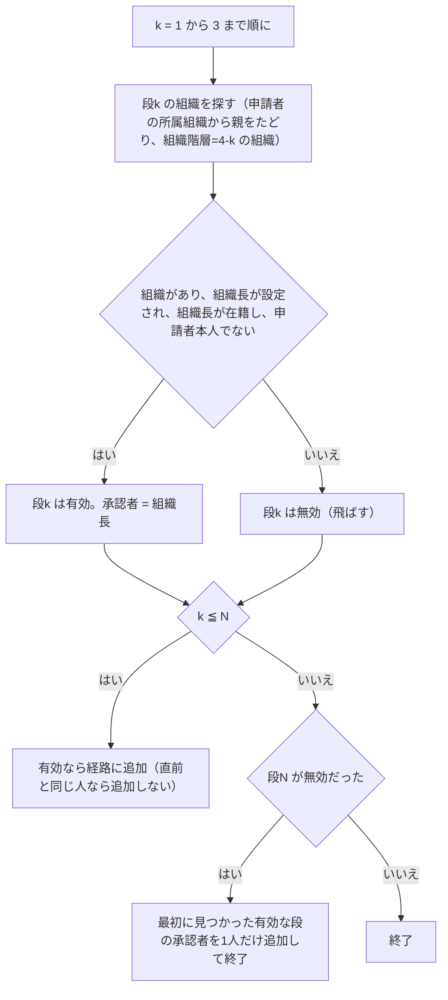
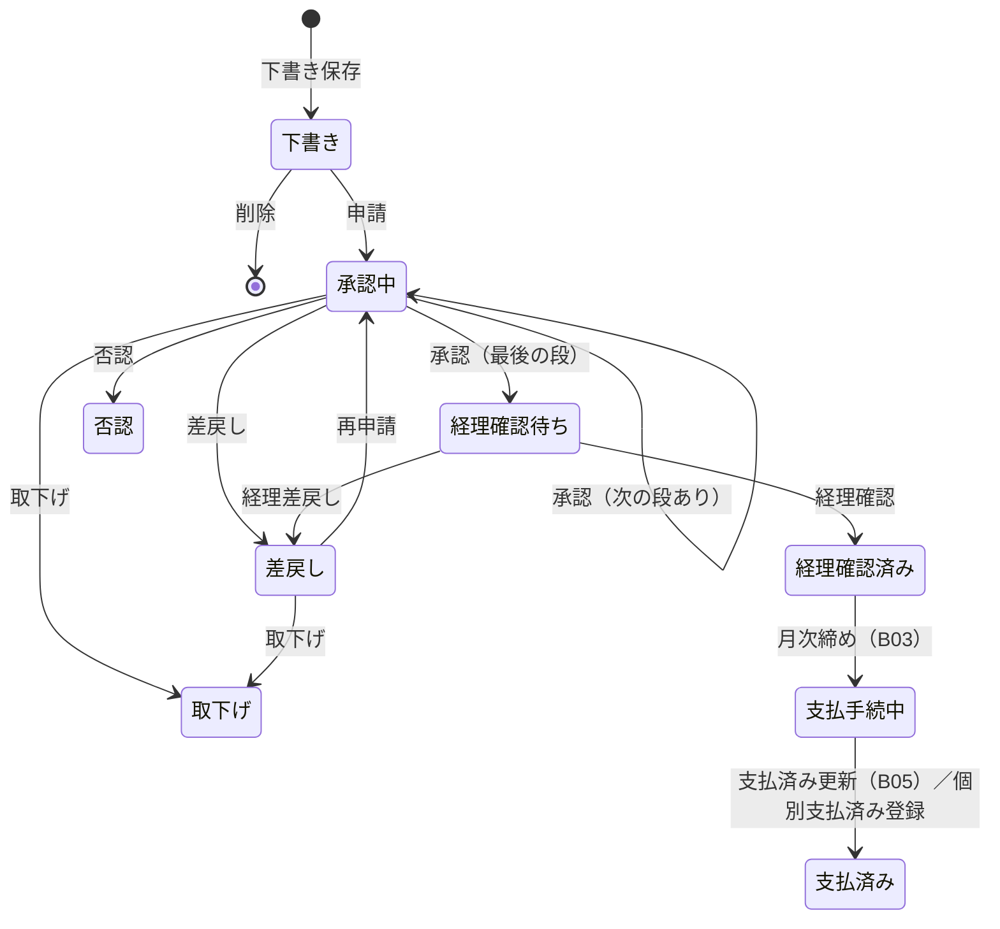

# 経費精算システム 基本設計書 04 業務ルール

| 項目 | 内容 |
|---|---|
| 文書番号 | EXP-BD-04 |
| 版数 | 1.3 |
| 作成部署 | インフォ商事株式会社 情報システム部 システム課 |
| 作成者 | 木村 |
| 承認者 | 井上（情報システム部長） |
| 根拠規程 | 旅費規程、経費精算規程、経理規程（いずれも管理本部 所管） |
| 最終更新日 | 2026-11-20 |

## 改訂履歴

| 版数 | 日付 | 改訂内容 | 作成者 | 承認者 |
|---|---|---|---|---|
| 1.0 | 2023-03-24 | 初版 | 木村 | 井上 |
| 1.1 | 2023-09-15 | BR-08 税区分・登録番号を追加。BR-04 に公共交通機関の金額基準を追加 | 木村 | 井上 |
| 1.2 | 2024-03-15 | BR-07 会議費の1人当たり上限を 10,000円に改定（2024-04-01 利用分から） | 林 | 井上 |
| 1.3 | 2026-11-20 | BR-01 に業務日付を追加。各ルールに数値例を追加 | 木村 | 井上 |

## 業務ルール一覧

| ID | ルール | 主に使う画面・バッチ |
|---|---|---|
| BR-01 | 共通（金額・日付・基準日・期間つきマスタの引き方） | 全体 |
| BR-02 | 承認ルート判定 | SCR-03、SCR-04 |
| BR-03 | 申請期限と遅延申請 | SCR-03 |
| BR-04 | 領収書の要否 | SCR-03 |
| BR-05 | 鉄道運賃と通勤定期区間の控除 | SCR-03 |
| BR-06 | 出張旅費（出張の要件・日当・宿泊費） | SCR-03 |
| BR-07 | 一般経費（勘定科目・会議費・参加者） | SCR-03、SCR-04 |
| BR-08 | 税区分・消費税額・登録番号 | SCR-03、SCR-04、B02 |
| BR-09 | 状態遷移（差戻し・再申請・取下げ・否認） | SCR-03、SCR-04 |
| BR-10 | 締め・支給年月・支払 | SCR-04、B03〜B05 |
| BR-11 | 申請番号の採番 | SCR-03 |

規程の数値はすべて設定値マスタ（m_setting）などのマスタに持ち、プログラムに直接書かない。本書の数値は 2026-11-20 時点の初期値である。

---

## BR-01 共通

### BR-01-1 金額・数値

| 項目 | ルール |
|---|---|
| 金額 | 円単位の整数。税込で扱う |
| 合計 | 申請の合計金額 = 明細の精算額の合計 |
| 割り算を含む比較 | 割り算をせず掛け算で比較する（例: 1人当たり ≦ 上限 は「金額 ≦ 上限 × 人数」で判定） |
| 消費税額の端数 | 切り捨て（BR-08） |
| 営業キロ | 0.1km 単位の整数で持つ（例: 7.5km → 75） |

### BR-01-2 日付と業務日付

| 項目 | ルール |
|---|---|
| 日付の形式 | `YYYY-MM-DD`。日時は `YYYY-MM-DD HH:MM:SS` |
| 業務日付 | 設定値 `OPERATION_DATE` が設定されていればその日付、空なら端末の日付 |
| 処理日時 | 業務日付 ＋ 端末の現在時刻 |
| 未来日 | 利用日・出発日・帰着日に業務日付より後の日付は指定できない |

### BR-01-3 基準日

期間つきのマスタ（有効開始日・有効終了日を持つもの）は、ルールごとに決まった基準日で1行を選ぶ。

| ルール | 使うマスタ | 基準日 |
|---|---|---|
| 承認ルートの段数（BR-02） | 承認ルート規則、設定値 | 申請日（再申請時は再申請日） |
| 申請期限（BR-03） | 設定値 | 初回申請日（未申請なら業務日付） |
| 領収書の要否（BR-04） | 設定値 | 明細の利用日 |
| 運賃・定期控除（BR-05） | 運賃、通勤定期区間 | 明細の利用日 |
| 日当・宿泊費上限・出張の要件（BR-06） | 日当・宿泊費基準、所属・役職履歴、設定値 | 出張の出発日 |
| 会議費の上限（BR-07） | 設定値 | 明細の利用日 |
| 税区分の特例上限（BR-08） | 設定値 | 明細の利用日 |

### BR-01-4 期間つきマスタの引き方

- 条件: `有効開始日 ≦ 基準日` かつ（`有効終了日 IS NULL` または `基準日 ≦ 有効終了日`）
- 該当行が0件または2件以上の場合は、マスタの設定誤りとして E-901 を表示し処理を中止する。

---

## BR-02 承認ルート判定

### BR-02-1 必要段数

必要段数 N = 次の3つの最大値。

| 要素 | 決め方 | 初期値 |
|---|---|---|
| 金額による段数 | 承認ルート規則（m_approval_rule）で、経費種別と申請の合計金額から決める | 下表 |
| 勘定科目による段数 | 一般経費の明細の勘定科目の「最低承認段数」の最大値 | 接待交際費のみ 2、他は 0 |
| 遅延による段数 | 遅延申請（BR-03）の場合、設定値 `LATE_MIN_APPROVAL_LEVEL` | 2 |

承認ルート規則（金額は「以上・未満」）:

| 経費種別 | 段数1 | 段数2 | 段数3 |
|---|---|---|---|
| 交通費（TR） | 0〜29,999円 | 30,000円以上 | — |
| 出張旅費（BT） | 0〜49,999円 | 50,000〜199,999円 | 200,000円以上 |
| 一般経費（GE） | 0〜49,999円 | 50,000〜299,999円 | 300,000円以上 |

段と承認者の対応:

| 段 | 名称 | 承認者 | 承認者の役職の下限（承認者変更時に使う） |
|---|---|---|---|
| 段1 | 課長承認 | 申請者の所属組織の上位（自組織を含む）にある「課」の組織長 | 課長（30） |
| 段2 | 部長承認 | 同じく「部」の組織長 | 部長（40） |
| 段3 | 本部長承認 | 同じく「本部」の組織長 | 本部長（50） |
| 段4 | 最終承認 | 設定値 `TOP_APPROVER_ORG` の組織（管理本部）の組織長 | 本部長（50） |

### BR-02-2 承認者の決め方

文章での定義:

1. 段1〜段N を順に見て、有効な段の承認者を経路に並べる。直前の承認者と同じ人（課長と部長の兼務など）は1つにまとめる。
2. 段N が無効だった場合（本人が組織長、組織長が不在、組織がない）、段N+1 から段3 へ順に見て、最初に有効な段の承認者を1人追加する。
3. 段3 まで見ても有効な段がない場合、段4（管理本部長）を追加する。
4. 申請者本人が管理本部長で、手順3 に至った場合は承認者を決定できない。E-129 を表示し申請させない（役員経費として別手続）。
5. 承認経路の最後に「経理確認」の段を付ける（承認者は特定しない。ロール ACCT を持つ申請者以外の者）。

組織長の「在籍」は社員マスタの在籍区分で判定する。組織・組織長は判定時点の値を使う（履歴は持たない）。

### BR-02-3 数値例（初期データの組織で検算済み）

組織: 営業本部（山本）＞ 第一営業部（高橋）＞ 営業一課（鈴木）・営業二課（伊藤）／ 第二営業部（中村）＞ 営業三課（組織長不在）／ 管理本部（加藤）

| No | 申請者（所属・役職） | 経費種別・内容 | 合計金額 | 必要段数 N | 承認ルート |
|---|---|---|---|---|---|
| 1 | 佐藤（営業一課・主任） | 一般経費 | 49,999 | 1 | 鈴木 |
| 2 | 佐藤（同） | 一般経費 | 50,000 | 2 | 鈴木 → 高橋 |
| 3 | 佐藤（同） | 一般経費 | 299,999 | 2 | 鈴木 → 高橋 |
| 4 | 佐藤（同） | 一般経費 | 300,000 | 3 | 鈴木 → 高橋 → 山本 |
| 5 | 佐藤（同） | 一般経費（接待交際費） | 8,000 | 2（科目） | 鈴木 → 高橋 |
| 6 | 渡辺（営業一課・一般） | 交通費（遅延申請） | 2,000 | 2（遅延） | 鈴木 → 高橋 |
| 7 | 鈴木（営業一課・課長） | 交通費 | 1,280 | 1 | 高橋（段1 が本人のため繰り上げ） |
| 8 | 鈴木（同） | 出張旅費 | 53,040 | 2 | 高橋（段1 は本人のため飛ばす） |
| 9 | 高橋（第一営業部・部長） | 一般経費 | 120,000 | 2 | 山本（段1 なし、段2 本人 → 段3 に繰り上げ） |
| 10 | 山本（営業本部・本部長） | 出張旅費 | 80,000 | 2 | 加藤（段1・段2 なし、段3 本人 → 段4） |
| 11 | 斎藤（営業三課・一般） | 交通費 | 5,000 | 1 | 中村（段1 が組織長不在 → 段2 に繰り上げ） |
| 12 | 斎藤（同） | 一般経費 | 60,000 | 2 | 中村（段1 不在、段2 有効） |
| 13 | 加藤（管理本部・本部長） | 交通費 | 1,000 | 1 | 決定不可（E-129） |

---

## BR-03 申請期限と遅延申請

| 項目 | ルール |
|---|---|
| 期限の起算日 | 交通費・一般経費: 明細の利用日のうち最も古い日。出張旅費: 帰着日 |
| 申請期限 | 起算日の属する月から `APPLY_DEADLINE_MONTHS`（初期値 1）か月後の月の末日（=翌月末日） |
| 判定日 | 初回申請日（申請回次1の申請日）。未申請なら業務日付 |
| 遅延申請 | 判定日 ＞ 申請期限 |
| 遅延申請の扱い | 遅延理由（必須、200文字以内）を入力させる（E-130）。承認の必要段数を `LATE_MIN_APPROVAL_LEVEL`（初期値 2）以上にする（BR-02） |
| 差戻し後の再申請 | 判定日は初回申請日のまま。再申請日が期限を過ぎても遅延申請にしない |

数値例（PowerShell で検算済み）:

| 起算日 | 申請期限 | 備考 |
|---|---|---|
| 2026-09-30 | 2026-10-31 | 2026-10-31 申請は期限内、2026-11-01 申請は遅延 |
| 2026-10-01 | 2026-11-30 | |
| 2026-10-31 | 2026-11-30 | 月末の起算日でも翌月末日 |
| 2026-12-15 | 2027-01-31 | 年をまたぐ |
| 2027-01-31 | 2027-02-28 | 平年 |
| 2028-01-15 | 2028-02-29 | うるう年 |

---

## BR-04 領収書の要否

明細1件ごとに判定する。判定に使う金額は明細の精算額（往復の場合は往復の合計）。基準日は利用日。

| 明細区分 | 要否 | 代替 |
|---|---|---|
| 鉄道（運賃算定）RAIL | 不要 | — |
| 鉄道・バス（手入力）PUBT | 精算額が `RECEIPT_MIN_PUBLIC_TRANSPORT`（初期値 30,000）以上で必須。未満は不要 | 支払方法が ICカード の場合、IC利用履歴で代替できる |
| タクシー TAXI | 金額にかかわらず必須 | なし |
| 航空 AIR | 金額にかかわらず必須（領収書または搭乗証明） | なし |
| 宿泊 HOTEL | 金額にかかわらず必須 | なし |
| 日当 ALLOW | 不要（添付不可） | — |
| 一般経費 GEN | 精算額が `RECEIPT_MIN_GENERAL`（初期値 5,000）以上で必須。未満は任意 | なし |

入力との関係:

| 判定結果 | 領収書区分「添付なし」 | 「領収書」 | 「IC利用履歴」 |
|---|---|---|---|
| 必須（代替あり） | エラー E-122 | 可 | 可（PUBT かつ ICカード払いのみ。それ以外は E-123） |
| 必須（代替なし） | エラー E-122 | 可 | エラー E-123 |
| 不要・任意 | 可 | 可 | PUBT かつ ICカード払いのみ可（それ以外は E-123） |
| 添付不可（日当） | 可 | 選択肢に出さない | 選択肢に出さない |

数値例:

| 明細 | 精算額 | 要否 |
|---|---|---|
| 一般経費（消耗品） | 4,999 | 任意 |
| 一般経費（消耗品） | 5,000 | 必須 |
| 鉄道・バス（手入力）片道 15,000 の往復 | 30,000 | 必須（ICカード払いなら IC利用履歴で可） |
| 鉄道・バス（手入力）片道 14,999 の往復 | 29,998 | 不要 |
| タクシー | 980 | 必須 |

---

## BR-05 鉄道運賃と通勤定期区間の控除

明細区分 RAIL（鉄道・運賃算定）に適用する。1明細 = 1路線の乗車（乗換えごとに明細を分ける）。

### BR-05-1 運賃の算定

1. 乗車キロ = |降車駅の営業キロ − 乗車駅の営業キロ|（0.1km 単位）
2. 運賃 = 運賃マスタ（m_fare）で、路線・基準日・乗車キロが「キロ下限 ≦ 乗車キロ ≦ キロ上限」の行の運賃
3. 該当行がない場合は E-131（手入力の明細で申請させる）

運賃マスタ（初期値、2023-04-01 から有効）:

| 路線 | キロ（0.1km単位） | 運賃 |
|---|---|---|
| みどり線（MD） | 1〜30 / 31〜60 / 61〜100 / 101〜150 / 151〜200 | 160 / 200 / 240 / 290 / 330 |
| さくら線（SK） | 1〜40 / 41〜80 / 81〜120 | 180 / 230 / 280 |

### BR-05-2 通勤定期区間の控除

申請者の通勤定期区間（m_commuter_pass、基準日=利用日で有効なもの）のうち、明細と同じ路線の区間と比べる。乗車区間 T=[Tmin, Tmax]、定期区間 P=[Pmin, Pmax]（いずれも営業キロ）。

| 判定 | 条件 | 控除後の片道運賃 |
|---|---|---|
| 定期区間なし | 同じ路線の有効な定期区間がない | 運賃（控除なし） |
| 重なりなし | Tmax ≦ Pmin または Tmin ≧ Pmax（端の駅で接するだけの場合を含む） | 運賃（控除なし） |
| 全区間が定期区間内 | Pmin ≦ Tmin かつ Tmax ≦ Pmax | 申請不可（E-113） |
| 一部重なる | 上記以外 | min（定期区間外の部分ごとの運賃の合計, 運賃） |

- 定期区間外の部分: Tmin < Pmin なら [Tmin, Pmin]、Tmax > Pmax なら [Pmax, Tmax]。部分ごとに BR-05-1 で運賃を求めて合計する。
- 合計が控除前の運賃を超える場合は控除前の運賃とする（控除額 0）。
- 控除額（片道）= 運賃 − 控除後の片道運賃
- 精算額 = 控除後の片道運賃 × 片道/往復（1 または 2）
- 乗車駅と降車駅の向き（上り・下り）は判定に関係しない。

### BR-05-3 数値例（PowerShell で検算済み）

駅（みどり線）: みどり北 0、青葉町 21、若松台 40、東公園 58、中央 75、港町 99、南浜 126、汐見ヶ浜 152
駅（さくら線）: 西の森 0、桜坂上 32、中央 60、川端町 81、東港 115

佐藤の定期区間: 〜2026-09-30 みどり線 青葉町〜中央 ／ 2026-10-01〜 みどり線 若松台〜中央（40〜75）

| No | 利用日 | 乗車 → 降車 | 乗車キロ | 運賃 | 定期区間外の部分 | 控除後の片道運賃 | 控除額 |
|---|---|---|---|---|---|---|---|
| 1 | 2026-11-10 | 東公園 → 港町 | 41 | 200 | [75,99]=24 → 160 | 160 | 40 |
| 2 | 2026-11-10 | 青葉町 → 港町 | 78 | 240 | [21,40]=19 → 160、[75,99]=24 → 160、計 320 | 240（320 ＞ 240 のため） | 0 |
| 3 | 2026-11-10 | みどり北 → 中央 | 75 | 240 | [0,40]=40 → 200 | 200 | 40 |
| 4 | 2026-11-10 | 若松台 → 東公園 | 18 | 160 | なし | 申請不可（E-113） | — |
| 5 | 2026-11-10 | 中央 → 若松台 | 35 | 200 | なし | 申請不可（E-113） | — |
| 6 | 2026-11-10 | 中央 → 南浜 | 51 | 200 | 重なりなし（中央で接する） | 200 | 0 |
| 7 | 2026-11-10 | みどり北 → 若松台 | 40 | 200 | 重なりなし（若松台で接する） | 200 | 0 |
| 8 | 2026-10-01 | 青葉町 → 中央 | 54 | 200 | [21,40]=19 → 160 | 160 | 40 |
| 9 | 2026-09-30 | 青葉町 → 中央 | 54 | 200 | なし（旧定期区間の全区間内） | 申請不可（E-113） | — |
| 10 | 2026-11-10 | さくら線 桜坂上 → 川端町 | 49 | 230 | 同じ路線の定期区間なし | 230 | 0 |

No.1 を往復で申請した場合の精算額 = 160 × 2 = 320。

田中の定期区間（さくら線 桜坂上〜中央 = 32〜60）で 桜坂上 → 川端町: 運賃 230、区間外 [60,81]=21 → 180、控除額 50。
鈴木の定期区間（みどり線 中央〜汐見ヶ浜 = 75〜152）で 中央 → みどり北: 運賃 240、重なりなし、控除額 0。

---

## BR-06 出張旅費

### BR-06-1 出張の要件

| 出張区分 | 要件 | エラー |
|---|---|---|
| 日帰り（DAY） | 出発日 = 帰着日。片道距離が `DAY_TRIP_MIN_KM`（初期値 100）km 以上 | E-116、E-117 |
| 宿泊（STAY） | 帰着日 ≧ 出発日 + 1 | E-115 |
| 共通 | 帰着日 ≧ 出発日。出張日数（帰着日 − 出発日 + 1）は 31 日以内。明細の利用日は出発日〜帰着日の範囲 | E-114、E-136、E-118 |

片道距離は申請者が入力する整数（km）。100km 未満の移動は交通費で申請する。

### BR-06-2 日当

| 項目 | ルール |
|---|---|
| 算定役職 | 出発日時点の役職（所属・役職履歴 m_assignment を出発日で引く）。見つからなければ E-137 |
| 日当単価 | 日当・宿泊費基準（m_travel_rate）を算定役職・出発日で引く。日帰りは「日帰り日当」、宿泊は「宿泊出張日当」 |
| 日数 | 日帰り: 1。宿泊: 帰着日 − 出発日 + 1 |
| 日当額 | 日当単価 × 日数 |
| 明細 | 日当明細（ALLOW）を1件、システムが自動で作る。利用日 = 出発日。申請者は編集・削除できない |

### BR-06-3 宿泊費

| 項目 | ルール |
|---|---|
| 明細 | 1泊ごとに1明細（HOTEL）。宿泊日は 出発日 ≦ 宿泊日 ＜ 帰着日（E-119）。同じ宿泊日は1明細まで（E-120） |
| 上限額 | 日当・宿泊費基準を算定役職・出発日で引き、宿泊地の地域区分（甲地 A／乙地 B）の上限を使う |
| 精算額 | min（実費, 上限額） |
| 自己負担額 | 実費 − 精算額（画面表示のみ。W-102 を表示） |

日当・宿泊費基準（初期値、2023-04-01 から有効）:

| 役職 | 日帰り日当 | 宿泊出張日当 | 宿泊費上限 甲地 | 宿泊費上限 乙地 |
|---|---|---|---|---|
| 一般（10）・主任（20） | 1,000 | 2,000 | 11,000 | 9,800 |
| 課長（30） | 1,500 | 2,500 | 13,000 | 11,000 |
| 部長（40） | 2,000 | 3,000 | 15,000 | 13,000 |
| 本部長（50） | 2,500 | 3,500 | 18,000 | 16,000 |

### BR-06-4 数値例（PowerShell で検算済み）

例1 鈴木（課長）2026-11-09〜11-11 2泊3日 甲地

| 明細 | 計算 | 精算額 |
|---|---|---|
| 日当 | 2,500 × 3日 | 7,500 |
| 宿泊 11-09 | 実費 14,500、上限 13,000 → min | 13,000（自己負担 1,500） |
| 宿泊 11-10 | 実費 12,800、上限 13,000 → min | 12,800 |
| 特急（手入力）往路・復路 | 9,870 × 2明細 | 19,740 |
| 合計 | | 53,040 → 出張旅費 50,000以上 → N=2 → 承認ルート 高橋 |

例2 伊藤 2026-09-29〜10-02 3泊4日 乙地（2026-10-01 に主任から課長へ昇格）

| 明細 | 計算 | 精算額 |
|---|---|---|
| 算定役職 | 出発日 2026-09-29 時点 = 主任（20） | — |
| 日当 | 2,000 × 4日（課長の単価なら 2,500 × 4 = 10,000 になるが使わない） | 8,000 |
| 宿泊 3泊 | 実費 9,800 × 3、上限 9,800（主任・乙地） | 29,400 |
| 新幹線等（手入力） | 6,400 × 2明細 | 12,800 |
| 合計 | | 50,200 → N=2。申請日（10-05）時点で伊藤は営業二課長のため段1 は本人 → 承認ルート 高橋 |

例3 田中（一般）日帰り 片道距離 100km: 日当 1,000。片道距離 99km は E-117。

例4 山本（本部長）2泊3日 甲地: 日当 3,500 × 3 = 10,500、宿泊 min(19,000, 18,000) + min(17,500, 18,000) = 35,500、航空 17,000 × 2 = 34,000、合計 80,000。

---

## BR-07 一般経費

### BR-07-1 勘定科目

| コード | 科目名 | 一般経費で選択 | 最低承認段数 | 参加者の記入 | 会議費の上限判定 | 税の対象 |
|---|---|---|---|---|---|---|
| 6110 | 旅費交通費 | 不可（交通費・出張旅費で自動設定） | 0 | 不要 | なし | 対象 |
| 6120 | 会議費 | 可 | 0 | 必須 | あり（飲食を伴う場合） | 対象 |
| 6130 | 接待交際費 | 可 | 2 | 必須 | なし | 対象 |
| 6140 | 消耗品費 | 可 | 0 | 不要 | なし | 対象 |
| 6150 | 新聞図書費 | 可 | 0 | 不要 | なし | 対象 |
| 6160 | 通信費 | 可 | 0 | 不要 | なし | 対象 |
| 6170 | 研修費 | 可 | 0 | 不要 | なし | 対象 |
| 6180 | 租税公課 | 可 | 0 | 不要 | なし | 対象外（税区分 X00） |
| 6190 | 雑費 | 可 | 0 | 不要 | なし | 対象 |
| 2150 | 未払金 | 不可（仕訳の貸方のみ） | — | — | — | — |

### BR-07-2 会議費の1人当たり上限

| 項目 | ルール |
|---|---|
| 対象 | 勘定科目の「会議費の上限判定」があり、かつ明細の「飲食を伴う」がオン |
| 判定 | 精算額 ≦ `MEAL_LIMIT_PER_PERSON` × 参加人数 なら可。超える場合は E-126（接待交際費で申請させる） |
| 上限の履歴 | 〜2024-03-31 利用分: 5,000円。2024-04-01 利用分〜: 10,000円 |

数値例: 3人 30,000円 → 可（1人当たり 10,000）。3人 30,001円 → E-126。1人 10,000円 → 可。1人 10,001円 → E-126。

---

## BR-08 税区分・消費税額・登録番号

### BR-08-1 税区分コード

| コード | 名称 | 意味 |
|---|---|---|
| T10 | 課税10% 適格 | 登録番号のある請求書・領収書あり |
| T08 | 課税8% 適格 | 同上（軽減税率） |
| S10 | 課税10% 特例 | 帳簿の記載のみで扱えるもの（出張旅費等、少額の公共交通機関運賃） |
| N10 | 課税10% 経過措置 | 登録番号のない領収書あり |
| N08 | 課税8% 経過措置 | 同上（軽減税率） |
| Z10 | 課税10% 控除不可 | 領収書なし |
| Z08 | 課税8% 控除不可 | 同上（軽減税率） |
| X00 | 対象外 | 不課税・非課税の科目 |

控除割合などの計算は会計システムで行う。本システムは税区分を判定し連携するだけである。

### BR-08-2 判定順序（上から順に最初に当てはまるもの）

| 順 | 条件 | 税区分 |
|---|---|---|
| 1 | 勘定科目の「税の対象」が対象外、または一般経費の税率が「対象外」 | X00 |
| 2 | 経費種別が出張旅費（日当・宿泊・交通のすべての明細） | S10 |
| 3 | 明細区分が RAIL、または PUBT で精算額 ＜ `PUBLIC_TRANSPORT_SPECIAL_LIMIT`（初期値 30,000） | S10 |
| 4 | 登録番号の入力あり | T10（税率8%なら T08） |
| 5 | 領収書区分が「領収書」 | N10（税率8%なら N08） |
| 6 | 上記以外 | Z10（税率8%なら Z08） |

- 税率は一般経費の明細で選ぶ（10%／8%／対象外）。その他の明細は 10%。
- 経理担当者は経理確認時に税区分を変更できる（SCR-04）。変更後は自動判定し直さない。
- `RECEIPT_MIN_PUBLIC_TRANSPORT`（BR-04）と `PUBLIC_TRANSPORT_SPECIAL_LIMIT` は初期値が同じ 30,000 だが別の設定値であり、片方だけ変更することがある。

### BR-08-3 消費税額

| 税区分 | 消費税額 |
|---|---|
| X00 | 0 |
| 一般経費の明細 | 申請者が入力（領収書の記載額）。未入力なら自動計算 |
| 上記以外 | 自動計算 |

自動計算: 消費税額 = 切り捨て（精算額 × 税率 ÷ (100 + 税率)）

数値例: 5,500（10%）→ 500。3,240（8%）→ 240。1,234（10%）→ 112。160（10%）→ 14。

### BR-08-4 登録番号

| 項目 | ルール |
|---|---|
| 形式 | 半角英大文字「T」＋半角数字13桁（正規表現 `^T[0-9]{13}$`）。違反は E-125 |
| 入力対象 | PUBT、TAXI、AIR、HOTEL、GEN の明細（任意入力） |
| 実在確認 | 本システムでは行わない。経理担当者が経理確認時に国税庁の公表サイトで確認する |

---

## BR-09 状態遷移

### BR-09-1 状態コード

| コード | 状態 | 申請者が編集 | 終了状態 |
|---|---|---|---|
| 10 | 下書き | 可 | |
| 20 | 承認中 | 不可 | |
| 30 | 差戻し | 可 | |
| 40 | 経理確認待ち | 不可 | |
| 50 | 経理確認済み | 不可 | |
| 60 | 支払手続中 | 不可 | |
| 70 | 支払済み | 不可 | ○ |
| 80 | 取下げ | 不可 | ○ |
| 90 | 否認 | 不可 | ○ |

### BR-09-2 遷移

### BR-09-3 操作ごとの処理

| 操作 | 操作者 | 処理 |
|---|---|---|
| 申請 | 申請者 | 申請回次=1、初回申請日・申請日=処理日時。承認ルート判定（BR-02）で承認経路を作る。段1 を「承認待ち」、他の段を「待機」にする |
| 承認 | 承認待ちの段の承認者 | その段を「承認」。次の段を「承認待ち」にする。次が経理確認の段なら状態を 40 にする |
| 差戻し | 承認待ちの段の承認者、または経理担当者（状態 40） | その段を「差戻し」、残りの段を「取消」。状態を 30 にする。コメント必須（E-201） |
| 否認 | 承認待ちの段の承認者 | その段を「否認」、残りの段を「取消」。状態を 90 にする。コメント必須（E-201） |
| 再申請 | 申請者 | 申請回次 +1、申請日=処理日時（初回申請日は変えない）。承認ルートを再判定し、新しい申請回次の承認経路を段1 から作る（前の回次の承認は引き継がない） |
| 取下げ | 申請者（状態 20・30） | 承認待ち・待機の段を「取消」。状態を 80 にする |
| 経理確認 | 経理担当者（申請者本人を除く） | 経理確認の段を「承認」。状態を 50、経理確認日時・経理確認者を記録 |

### BR-09-4 経理確認時の勘定科目変更

経理担当者は一般経費の明細の勘定科目を変更できる。変更後の明細で BR-02-1 の必要段数を再計算し、申請時の必要段数を超える場合は変更を保存しない（E-304。差戻しで対応する）。

---

## BR-10 締め・支給年月・支払

| 項目 | ルール |
|---|---|
| 締めの単位 | 月。対象月の末日までに経理確認した申請を締める |
| 判定 | 経理確認日時の日付部分 ≦ 対象月の末日 |
| 支給年月 | 対象月の翌月 |
| 締めの条件 | 対象の申請がすべて仕訳連携済みであること（未連携があれば B03 はエラー E-404） |
| 二重締め | 同じ対象月の締めが成功済みなら B03 はエラー E-403 |
| 締め済み月の経理確認 | 業務日付の属する月が締め済みの場合、経理確認できない（E-303） |
| 支払 | 給与支給日（毎月25日。土日祝の場合の扱いは給与システムに従う）に給与と合わせて振り込む |
| 退職者 | 給与連携時点で退職済み（退職日 ≦ 業務日付）の社員は給与連携の対象外とし、B04 の警告に一覧を出す。経理担当者が個別に振り込み、SCR-04 で「個別支払済み登録」をする |

数値例（PowerShell で検算済み）:

| 経理確認日時 | 締める対象月 | 支給年月 |
|---|---|---|
| 2026-11-30 23:59:59 | 2026-11 | 2026-12 |
| 2026-12-01 00:00:00 | 2026-12 | 2027-01 |
| 2026-12-31 18:00:00 | 2026-12 | 2027-01 |

---

## BR-11 申請番号の採番

| 項目 | ルール |
|---|---|
| 形式 | `EX` ＋ 西暦4桁 ＋ `-` ＋ 連番6桁（例: EX2026-000123） |
| 採番時点 | 最初の下書き保存または申請のとき |
| 西暦 | 採番時点の業務日付の年 |
| 連番 | 同じ西暦の申請番号の連番の最大値 + 1。年が変わると 000001 から |
