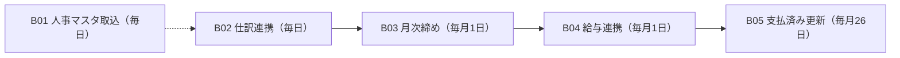

# 経費精算システム 基本設計書 05 バッチ・外部インターフェース

| 項目 | 内容 |
|---|---|
| 文書番号 | EXP-BD-05 |
| 版数 | 1.3 |
| 作成部署 | インフォ商事株式会社 情報システム部 システム課 |
| 作成者 | 木村 |
| 承認者 | 井上（情報システム部長） |
| 最終更新日 | 2026-11-20 |

## 改訂履歴

| 版数 | 日付 | 改訂内容 | 作成者 | 承認者 |
|---|---|---|---|---|
| 1.0 | 2023-03-24 | 初版 | 木村 | 井上 |
| 1.1 | 2023-09-15 | IF-11 仕訳連携ファイルに税区分・消費税額・登録番号を追加（会計システム側の改修と同時に適用） | 木村 | 井上 |
| 1.3 | 2026-11-20 | バッチ実行画面（SCR-08）からの手動起動を追加。B03 の前提チェックを追加 | 木村 | 井上 |

## 1. バッチ一覧

| バッチID | バッチ名 | 定時起動 | 本版の起動方法 | 入力 | 出力 | 更新するテーブル |
|---|---|---|---|---|---|---|
| B01 | 人事マスタ取込 | 毎日 05:00 | SCR-08 で4ファイルを選択して実行 | IF-01〜IF-04 | — | m_organization、m_employee、m_assignment、m_commuter_pass |
| B02 | 仕訳連携 | 毎日 22:00 | SCR-08 で実行 | DB | IF-11 | t_expense_report.journal_run_id |
| B03 | 月次締め | 毎月1日 01:00 | SCR-08 で対象年月を指定して実行 | DB | — | t_expense_report（状態・支給年月・締め日時） |
| B04 | 給与連携 | 毎月1日 02:00（B03 の後） | SCR-08 で支給年月を指定して実行 | DB | IF-21 | t_expense_report.payroll_run_id |
| B05 | 支払済み更新 | 毎月26日 01:00 | SCR-08 で支給年月を指定して実行 | DB | — | t_expense_report（状態・支払日時・支払方法） |

本版では定時起動を行わない。定時起動の時刻は運用手順上の実行時刻を示す。

### 1.1 実行順序



| 前提 | チェックするバッチ | エラー |
|---|---|---|
| 締め対象の申請がすべて仕訳連携済み | B03 | E-404 |
| 対象年月が終わっている（業務日付 ＞ 対象年月の末日） | B03 | E-409 |
| 同じ対象年月の締めが未実行 | B03 | E-403 |
| 支給年月の前月を対象年月とする B03 が成功済み | B04 | E-407 |
| 同じ支給年月の給与連携が未実行 | B04 | E-408 |
| 同じ支給年月の B04 が成功済み | B05 | E-406 |
| 業務日付 ≧ 支給年月の26日 | B05 | E-405 |

「成功済み」は t_batch_run に同じバッチID・同じパラメータで結果が OK または WARN の行があること。

## 2. 共通仕様

| 項目 | 仕様 |
|---|---|
| トランザクション | 1回の実行を1トランザクションとする。エラー時はロールバックし、DB を実行前の状態に戻す |
| 実行履歴 | 結果にかかわらず t_batch_run に1行記録する（エラー時はロールバックの後に記録） |
| 結果 | OK=正常、WARN=警告あり（処理は完了）、NG=エラー（ロールバック済み） |
| 処理日時 | 業務日付＋端末の現在時刻 |
| 実行者 | ログイン利用者の社員番号 |
| メッセージ | 正常 I-401、警告 W-4xx、エラー E-4xx（02 の6章） |

### 2.1 ファイル形式（全インターフェース共通）

| 項目 | 仕様 |
|---|---|
| 形式 | CSV（カンマ区切り） |
| 文字コード | UTF-8。出力は BOM なし。入力は BOM があれば読み飛ばす |
| 改行 | 出力は CRLF。入力は CRLF・LF のどちらも受け付ける |
| 引用符 | 型 X（文字）は必ず `"` で囲む。値の中の `"` は `""` にする。型 9（数値）は囲まない |
| 数値 | 半角数字、ゼロ埋めなし、カンマなし。負数は使わない |
| 日付 | `YYYYMMDD`（IF-11・IF-21）、`YYYY-MM-DD`（IF-01〜IF-04） |
| 空値 | 文字は `""`、日付も `""` |
| 桁 | 文字数。超える場合、取込はエラー、出力は桁で切り捨て（摘要のみ） |

## 3. 人事システムからの取込（B01）

### 3.1 処理

| 順 | 処理 | エラー時 |
|---|---|---|
| 1 | 4つのファイルがすべて選ばれているか確認 | E-402（ファイル名を差し込み） |
| 2 | 各ファイルの1行目（見出し行）が 3.2 の列名と順序どおりか確認 | E-401（行=1） |
| 3 | 2行目以降を読み、項目ごとに必須・桁・形式・コード値を確認 | E-401（ファイル名・行番号・「{列名}が不正です（値: {値}）」） |
| 4 | `PRAGMA foreign_keys = OFF` にしてトランザクション開始 | — |
| 5 | m_organization・m_assignment・m_commuter_pass を全件削除して取込ファイルの内容を登録（洗い替え） | — |
| 6 | m_employee は社員番号で登録または更新。ファイルにない社員は変更しない（削除しない） | — |
| 7 | 在籍区分を設定: 退職日 ≦ 業務日付 なら 9、それ以外は 1 | — |
| 8 | 整合チェック（3.3）。違反があればロールバック | E-401（ファイル名・行番号・内容） |
| 9 | `PRAGMA foreign_key_check` で違反がないか確認。違反があればロールバック | E-401 |
| 10 | コミットし、`PRAGMA foreign_keys = ON` に戻す | — |
| 11 | 承認待ち・待機の承認段の承認者が、退職者、または BR-02-2 で今判定した段の組織長と異なる申請を数え、1件以上なら W-402（申請番号をカンマ区切りで差し込み） | — |

処理件数 = 社員ファイルの件数。

### 3.2 ファイルレイアウト

#### IF-01 組織ファイル（organization.csv）

| No | 列名（見出し） | 項目名 | 型 | 桁 | 必須 | チェック |
|---|---|---|---|---|---|---|
| 1 | org_code | 組織コード | X | 4 | ○ | 数字4桁。ファイル内で重複なし |
| 2 | org_name | 組織名 | X | 40 | ○ | |
| 3 | org_level | 組織階層 | 9 | 1 | ○ | 1・2・3 |
| 4 | parent_org_code | 親組織コード | X | 4 | 階層2・3 で ○ | 階層1 は空 |
| 5 | manager_employee_id | 組織長社員番号 | X | 6 | | 数字6桁 |
| 6 | valid_from | 有効開始日 | X | 10 | ○ | 日付 |
| 7 | valid_to | 有効終了日 | X | 10 | | 日付 |

#### IF-02 社員ファイル（employee.csv）

| No | 列名（見出し） | 項目名 | 型 | 桁 | 必須 | チェック |
|---|---|---|---|---|---|---|
| 1 | employee_id | 社員番号 | X | 6 | ○ | 数字6桁。ファイル内で重複なし |
| 2 | employee_name | 氏名 | X | 40 | ○ | |
| 3 | employee_name_kana | 氏名カナ | X | 40 | ○ | |
| 4 | email | メールアドレス | X | 100 | ○ | `@` を1つ含む |
| 5 | org_code | 所属組織コード | X | 4 | ○ | 組織ファイルに存在 |
| 6 | position_code | 役職コード | X | 2 | ○ | コード POSITION |
| 7 | hire_date | 入社日 | X | 10 | ○ | 日付 |
| 8 | retire_date | 退職日 | X | 10 | | 日付。入社日以降 |

#### IF-03 発令ファイル（assignment.csv）

| No | 列名（見出し） | 項目名 | 型 | 桁 | 必須 | チェック |
|---|---|---|---|---|---|---|
| 1 | employee_id | 社員番号 | X | 6 | ○ | 社員ファイルに存在 |
| 2 | valid_from | 発令日 | X | 10 | ○ | 日付 |
| 3 | valid_to | 有効終了日 | X | 10 | | 日付。発令日以降 |
| 4 | org_code | 所属組織コード | X | 4 | ○ | 組織ファイルに存在 |
| 5 | position_code | 役職コード | X | 2 | ○ | コード POSITION |

#### IF-04 通勤経路ファイル（commuter.csv）

| No | 列名（見出し） | 項目名 | 型 | 桁 | 必須 | チェック |
|---|---|---|---|---|---|---|
| 1 | employee_id | 社員番号 | X | 6 | ○ | 社員ファイルに存在 |
| 2 | valid_from | 有効開始日 | X | 10 | ○ | 日付 |
| 3 | valid_to | 有効終了日 | X | 10 | | 日付 |
| 4 | seq | 区間連番 | 9 | 1 | ○ | 1〜3 |
| 5 | line_code | 路線コード | X | 2 | ○ | コード LINE |
| 6 | from_station_code | 区間の駅1 | X | 4 | ○ | m_station に存在し、路線が line_code と一致 |
| 7 | to_station_code | 区間の駅2 | X | 4 | ○ | 同上。駅1 と異なる |

### 3.3 整合チェック

| No | チェック | 対象 |
|---|---|---|
| 1 | 組織長社員番号が m_employee に存在する | 組織 |
| 2 | 親組織の組織階層 = 自組織の組織階層 − 1 | 組織 |
| 3 | 同じ社員の発令の期間が重ならない | 発令 |
| 4 | 同じ社員・同じ有効開始日の通勤経路で区間連番が重複しない | 通勤経路 |

## 4. 会計システムへの仕訳連携（B02）

### 4.1 処理

| 順 | 処理 |
|---|---|
| 1 | 対象: 状態が 50・60・70、仕訳連携実行ID が NULL、経理確認日時の日付部分 ≦ 業務日付。経理確認日時・申請番号の順 |
| 2 | 申請ごとに、明細の順に借方の D レコードを1行ずつ、最後に貸方の D レコードを1行作る |
| 3 | 対象の申請の仕訳連携実行ID に今回の実行ID を設定 |
| 4 | ファイルを出力（ダウンロード）。対象0件でも H・T レコードだけのファイルを出力し W-401 |
| 5 | 処理件数 = 対象の申請の件数、金額合計 = 借方合計 |

ファイル名: `JRNL_EXP_{業務日付YYYYMMDD}_{時刻HHMMSS}.csv`

### 4.2 IF-11 仕訳連携ファイル

レコード構成: H（1行）→ D（0行以上）→ T（1行）。見出し行はない。

H レコード:

| No | 項目名 | 型 | 桁 | 内容 |
|---|---|---|---|---|
| 1 | レコード区分 | X | 1 | `H` |
| 2 | ファイル作成日時 | X | 14 | `YYYYMMDDHHMMSS`（処理日時） |
| 3 | 送信元システム | X | 3 | `EXP` |
| 4 | 業務日付 | X | 8 | `YYYYMMDD` |

D レコード:

| No | 項目名 | 型 | 桁 | 借方（明細ごと） | 貸方（申請ごとに1行） |
|---|---|---|---|---|---|
| 1 | レコード区分 | X | 1 | `D` | `D` |
| 2 | 伝票日付 | X | 8 | 経理確認日 | 同左 |
| 3 | 伝票番号 | X | 13 | 申請番号 | 同左 |
| 4 | 行番号 | 9 | 3 | 明細番号 | 明細件数 + 1 |
| 5 | 貸借区分 | X | 1 | `1` | `2` |
| 6 | 勘定科目コード | X | 4 | 明細の勘定科目 | `2150`（未払金） |
| 7 | 補助科目コード | X | 6 | 空 | 申請者の社員番号 |
| 8 | 部門コード | X | 4 | 申請時所属 | 同左 |
| 9 | 税区分コード | X | 3 | 明細の税区分 | 空 |
| 10 | 金額 | 9 | 9 | 明細の精算額 | 申請の合計金額 |
| 11 | 消費税額 | 9 | 9 | 明細の消費税額 | 0 |
| 12 | 登録番号 | X | 14 | 明細の登録番号（なければ空） | 空 |
| 13 | 摘要 | X | 40 | 一般経費は「支払先 内容」、それ以外は用務・内容。40文字で切り捨て | 「立替経費 」＋申請者氏名 |

T レコード:

| No | 項目名 | 型 | 桁 | 内容 |
|---|---|---|---|---|
| 1 | レコード区分 | X | 1 | `T` |
| 2 | D レコード件数 | 9 | 7 | 借方・貸方を合わせた件数 |
| 3 | 借方合計 | 9 | 12 | 貸借区分 1 の金額の合計 |
| 4 | 貸方合計 | 9 | 12 | 貸借区分 2 の金額の合計 |

会計システムは T レコードの件数・合計とファイルの内容が一致しない場合、ファイル全体を取り込まない。

### 4.3 出力例

初期データの業務日付 2026-11-30 で B02 を実行した場合の対象は No.12（5,800）・No.14（53,040）・No.23（3,240）の3件、D レコード 11 行、借方合計 = 貸方合計 = 62,080（PowerShell で検算済み）。そのうち No.14 の部分（氏名は姓のみ記載）:

```csv
"H","20261130220000","EXP","20261130"
"D","20261130","EX2026-000014",1,"1","6110","","1110","S10",9870,897,"","中央→北部市（特急）"
"D","20261130","EX2026-000014",2,"1","6110","","1110","S10",13000,1181,"","北部市駅前ホテル"
"D","20261130","EX2026-000014",3,"1","6110","","1110","S10",12800,1163,"","北部市駅前ホテル"
"D","20261130","EX2026-000014",4,"1","6110","","1110","S10",9870,897,"","北部市→中央（特急）"
"D","20261130","EX2026-000014",5,"1","6110","","1110","S10",7500,681,"","日当"
"D","20261130","EX2026-000014",6,"2","2150","100003","1110","",53040,0,"","立替経費 鈴木"
"T",11,62080,62080
```

（例では No.12・No.23 の D レコードを省略している。T レコードはファイル全体の値。）

## 5. 月次締め（B03）

| 順 | 処理 | エラー |
|---|---|---|
| 1 | パラメータ: 対象年月 `YYYY-MM` | 形式不正は E-401（行=0） |
| 2 | 業務日付 ＞ 対象年月の末日 であること | E-409 |
| 3 | 同じ対象年月の B03 が成功済みでないこと | E-403 |
| 4 | 対象: 状態 50 の申請を読み、`InfoExp.logic.settlement.isCloseTarget`（経理確認日時の日付部分 ≦ 対象年月の末日）で絞る | — |
| 5 | 対象のうち仕訳連携実行ID が NULL のものがあればエラー | E-404 |
| 6 | 対象の状態を 60、支給年月 = 対象年月の翌月、締め日時 = 処理日時 に更新 | — |
| 7 | 処理件数 = 対象件数、金額合計 = 合計金額の合計 | — |

数値例: 初期データで業務日付を 2026-12-01 にし、B02 → B03（対象年月 2026-11）の順に実行すると、No.12・14・16・19・20・23 の6件、合計 184,400 が締められ支給年月 2026-12 になる（PowerShell で検算済み）。B02 を実行せずに B03 を実行すると、No.12・14・23 が未連携のため E-404（3件）。

## 6. 給与システムへの給与連携（B04）

### 6.1 処理

| 順 | 処理 | エラー・警告 |
|---|---|---|
| 1 | パラメータ: 支給年月 `YYYY-MM` | — |
| 2 | 対象年月 = 支給年月の前月 の B03 が成功済みであること | E-407 |
| 3 | 同じ支給年月の B04 が成功済みでないこと | E-408 |
| 4 | 対象: 状態 60、支給年月 = パラメータ、給与連携実行ID が NULL | — |
| 5 | 申請者が退職（在籍区分 9、または退職日 ≦ 業務日付）の申請は対象から外す | W-403（申請番号をカンマ区切りで差し込み） |
| 6 | 社員番号ごとに合計金額と件数を集計し、社員番号の順に D レコードを作る | — |
| 7 | 出力した申請の給与連携実行ID に今回の実行ID を設定 | — |
| 8 | ファイルを出力（ダウンロード）。0件なら H・T のみで W-401 | — |
| 9 | 処理件数 = D レコード件数（社員数）、金額合計 = 金額の合計 | — |

ファイル名: `PAY_EXP_{支給年月YYYYMM}.csv`

### 6.2 IF-21 給与連携ファイル

| レコード | No | 項目名 | 型 | 桁 | 内容 |
|---|---|---|---|---|---|
| H | 1 | レコード区分 | X | 1 | `H` |
| H | 2 | ファイル作成日時 | X | 14 | `YYYYMMDDHHMMSS` |
| H | 3 | 送信元システム | X | 3 | `EXP` |
| H | 4 | 支給年月 | X | 6 | `YYYYMM` |
| D | 1 | レコード区分 | X | 1 | `D` |
| D | 2 | 社員番号 | X | 6 | |
| D | 3 | 支給年月 | X | 6 | `YYYYMM` |
| D | 4 | 支給項目コード | X | 4 | `K501`（立替経費精算・非課税支給） |
| D | 5 | 金額 | 9 | 9 | 社員ごとの合計金額 |
| D | 6 | 申請件数 | 9 | 3 | |
| T | 1 | レコード区分 | X | 1 | `T` |
| T | 2 | D レコード件数 | 9 | 7 | |
| T | 3 | 金額合計 | 9 | 12 | |

### 6.3 出力例

5章の数値例に続けて B04（支給年月 2026-12）を実行した場合。清水（2026-11-15 退職）の No.20 は対象外となり W-403。D レコード 5 件、合計 182,400（PowerShell で検算済み）。

```csv
"H","20261201020000","EXP","202612"
"D","100002","202612","K501",120000,1
"D","100003","202612","K501",53040,1
"D","100012","202612","K501",5800,1
"D","100014","202612","K501",320,1
"D","200012","202612","K501",3240,1
"T",5,182400
```

## 7. 支払済み更新（B05）

| 順 | 処理 | エラー |
|---|---|---|
| 1 | パラメータ: 支給年月 `YYYY-MM` | — |
| 2 | 同じ支給年月の B04 が成功済みであること | E-406 |
| 3 | 業務日付 ≧ 支給年月の26日 | E-405 |
| 4 | 対象: 状態 60、支給年月 = パラメータ、給与連携実行ID が NULL でない | — |
| 5 | 状態を 70、支払日時 = 処理日時、支払方法 = P に更新 | — |
| 6 | 処理件数 = 対象件数、金額合計 = 合計金額の合計 | — |

給与連携の対象外となった申請（退職者）は状態 60 のまま残り、経理担当者が SCR-04 の個別支払済み登録で 70 にする。
