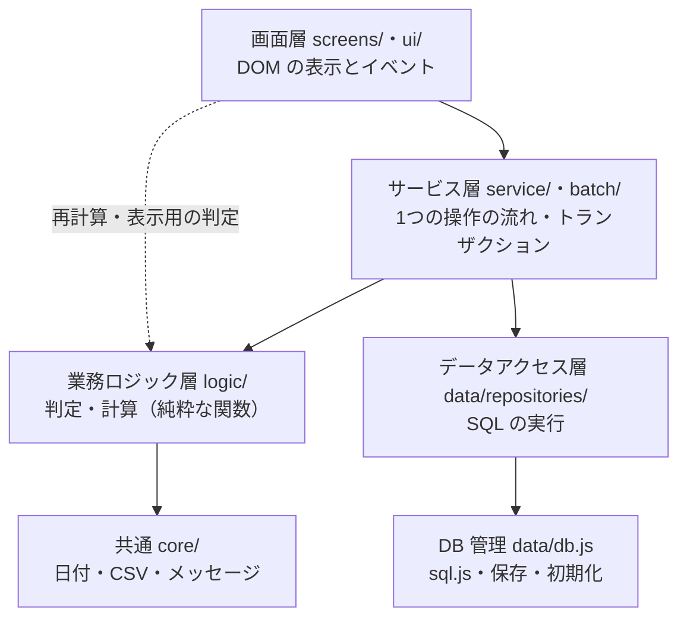
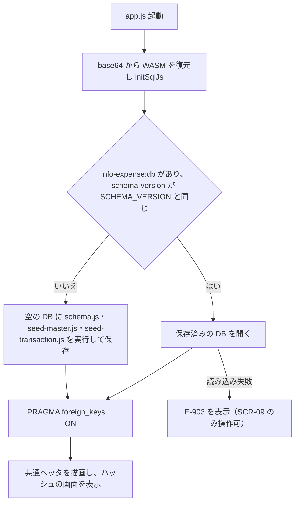

# 経費精算システム 基本設計書 06 方式設計

| 項目 | 内容 |
|---|---|
| 文書番号 | EXP-BD-06 |
| 版数 | 1.3 |
| 作成部署 | インフォ商事株式会社 情報システム部 システム課 |
| 作成者 | 木村 |
| 承認者 | 井上（情報システム部長） |
| 最終更新日 | 2026-11-20 |

## 改訂履歴

| 版数 | 日付 | 改訂内容 | 作成者 | 承認者 |
|---|---|---|---|---|
| 1.0 | 2023-03-24 | 初版 | 木村 | 井上 |
| 1.3 | 2026-11-20 | 業務ロジック層の関数一覧（5章）と自動テストの仕組み（9章）を追加 | 木村 | 井上 |

## 1. 方式の前提

| 項目 | 方式 | 理由・制約 |
|---|---|---|
| 動作環境 | Microsoft Edge（Windows）で `index.html` をファイルとして直接開く（`file://`） | インストール作業なしで使える |
| サーバー | なし | |
| 言語 | HTML、CSS、JavaScript | ビルド工程を持たない |
| スクリプトの読み込み | クラシックスクリプト（`<script src>`）。ES モジュール（`type="module"`）は使わない | `file://` では ES モジュールと `fetch` が使えない |
| 外部ライブラリ | sql.js 1.10.3 のみ。テストも含め、他の外部ライブラリは使わない | 同梱物を最小にする |
| DB | sql.js（ブラウザ内で動く SQLite） | SQL でデータを扱う |
| WASM の読み込み | sql.js の WASM を base64 文字列にして JS ファイルに埋め込み、`initSqlJs({ wasmBinary })` に渡す | `file://` で WASM ファイルを取得できないため |
| DDL・初期データ | SQL 文字列を書いた JS ファイルで持つ | 同上 |
| データの保存 | DB 全体をバイナリで書き出し、base64 にして localStorage に保存 | |
| 認証 | 行わない。共通ヘッダの利用者切替で操作者を選ぶ | 研修・検証用環境 |
| 外部連携ファイル | 取込はファイル選択（`<input type="file">` と FileReader）、出力はダウンロード（Blob） | `file://` でファイルシステムに直接書けないため |
| 画面の切り替え | 1つの `index.html` の中で、URL のハッシュ（`#/reports` など）で画面を切り替える | |

## 2. 層の構成



| 層 | フォルダ | 役割 | してはいけないこと |
|---|---|---|---|
| 画面層 | `js/screens/`、`js/ui/` | 画面の描画、入力値の取得、メッセージ表示、サービス呼び出し | SQL を書く。業務ルールを自前で計算する（必ず logic の関数を呼ぶ） |
| サービス層 | `js/service/`、`js/batch/` | マスタ・データの読み込み → logic で判定 → 書き込み、トランザクション、状態の再確認（E-202） | DOM に触る |
| 業務ロジック層 | `js/logic/` | BR-01〜BR-11 の判定・計算 | DOM・DB・localStorage・現在時刻（`new Date()` の引数なし呼び出し）・乱数・グローバル変数に触る |
| データアクセス層 | `js/data/repositories/` | テーブルごとの SQL。DB の行（snake_case）と JS のオブジェクト（camelCase）の変換 | 業務ルールの判定 |
| DB 管理 | `js/data/db.js` | sql.js の初期化、DDL・初期データの投入、保存、データ初期化、トランザクションの補助 | |
| 共通 | `js/core/` | 名前空間、設定、日付操作、CSV、メッセージ | DOM・DB に触る（`core/` の関数も純粋な関数とする） |

画面の再計算（02 の 5.3.5）とサービス層の申請時チェックは、同じ logic の関数を呼ぶ。同じ判定を2か所に書かない。

## 3. フォルダ構成

```
info-expense-system/
├── index.html                    画面（全画面の入れ物）
├── css/
│   └── app.css
├── js/
│   ├── lib/
│   │   ├── sql-wasm.js           sql.js 1.10.3 本体（配布物そのまま）
│   │   └── sql-wasm-binary.js    WASM の base64（window.INFO_EXP_SQL_WASM_BASE64）
│   ├── core/
│   │   ├── namespace.js          window.InfoExp の作成（最初に読み込む）
│   │   ├── config.js             SCHEMA_VERSION、localStorage のキー
│   │   ├── messages.js           メッセージ一覧（02 の6章）と差し込み関数
│   │   ├── date-util.js          日付の計算
│   │   └── csv.js                CSV の解析・作成
│   ├── logic/                    業務ロジック（5章）
│   │   ├── master-lookup.js
│   │   ├── approval-route.js
│   │   ├── apply-deadline.js
│   │   ├── receipt-rule.js
│   │   ├── rail-fare.js
│   │   ├── travel-expense.js
│   │   ├── general-expense.js
│   │   ├── tax-category.js
│   │   ├── report-status.js
│   │   ├── settlement.js
│   │   ├── report-number.js
│   │   └── report-validator.js
│   ├── data/
│   │   ├── schema.js             DDL（SQL 文字列）
│   │   ├── seed-master.js        マスタの初期データ（INSERT 文）
│   │   ├── seed-transaction.js   申請などの初期データ（INSERT 文）
│   │   ├── db.js
│   │   └── repositories/         テーブルごと（例: expense-report-repository.js）
│   ├── service/                  操作ごと（例: report-service.js、approval-service.js）
│   ├── batch/                    b01-hr-import.js 〜 b05-payment-complete.js
│   ├── ui/                       router.js、header.js、components.js
│   ├── screens/                  scr01-home.js 〜 scr09-system.js
│   └── app.js                    起動処理（最後に読み込む）
├── tests/
│   ├── test.html                 単体試験の実行ページ（9章）
│   ├── runner/
│   │   └── test-runner.js        テストランナー（自作）
│   ├── unit/
│   │   ├── fixtures.js           テスト用のマスタデータ
│   │   └── *.test.js             logic のファイルごとの単体試験
│   └── run-tests.ps1             PowerShell から単体試験を実行
├── samples/
│   └── hr/                       B01 の取込ファイルの例（IF-01〜IF-04）
├── docs/                         基本設計書（本書を含む）
└── team/                         開発チームの手順書
```

## 4. スクリプトの読み込み順（index.html）

1. `js/lib/sql-wasm.js`、`js/lib/sql-wasm-binary.js`
2. `js/core/namespace.js` → `config.js` → `messages.js` → `date-util.js` → `csv.js`
3. `js/logic/` の全ファイル（`master-lookup.js` を最初に。他はファイル間で呼び出しがあれば呼ばれる側を先に）
4. `js/data/schema.js` → `seed-master.js` → `seed-transaction.js` → `db.js` → `repositories/`
5. `js/service/`、`js/batch/`
6. `js/ui/`、`js/screens/`
7. `js/app.js`

すべてのファイルは即時関数で囲み、`'use strict';` を書き、`window.InfoExp` の下に登録する。グローバル変数を増やさない（例外: `INFO_EXP_SQL_WASM_BASE64`、sql.js の `initSqlJs`）。

## 5. 業務ロジック層の関数

### 5.1 共通の約束

| 項目 | 約束 |
|---|---|
| 純粋な関数 | 同じ引数なら必ず同じ結果を返す。引数のオブジェクトを書き換えない |
| 日付 | 文字列 `YYYY-MM-DD` で受け渡す。「今日」は引数 `operationDate` で受け取る |
| マスタ | 必要なマスタの行は配列で引数に渡す（DB から読むのはサービス層） |
| 金額 | 整数（円）。小数を返さない |
| エラーの返し方 | 入力チェック・判定の結果としてのエラーは、例外ではなく `{ msgId, params, itemNo, field }` の配列で返す。`itemNo` は明細番号（明細以外は null） |
| 例外 | マスタの設定誤り（BR-01-4 で0件・2件以上）のみ `InfoExp.core.ConfigError`（`msgId: 'E-901'`）を投げる |
| 名前 | `InfoExp.logic.{ファイル名を camelCase にしたもの}.{関数名}`（例: `InfoExp.logic.receiptRule.judgeReceiptRequired`） |

### 5.2 関数一覧

| ファイル | 関数 | 引数 | 戻り値 | ルール |
|---|---|---|---|---|
| master-lookup.js | `pickEffective(rows, baseDate, masterName)` | 期間つきマスタの行の配列（`validFrom`・`validTo` を持つ）、基準日、マスタ名（エラー表示用） | 1行。0件・2件以上は ConfigError | BR-01-4 |
| master-lookup.js | `getSettingNumber(settingRows, key, baseDate)` | m_setting の行の配列、設定キー、基準日 | 整数 | BR-01-4 |
| approval-route.js | `calcRequiredLevel(p)` | `{ expenseType, totalAmount, applyDate, ruleRows, accountCodes, accountRows, isLate, lateMinLevel }` | 必要段数 N（1〜3） | BR-02-1 |
| approval-route.js | `buildRoute(p)` | `{ applicantId, applicantOrgCode, requiredLevel, orgRows, employeeRows, topApproverOrgCode }` | `{ steps: [{ stepNo, level, approverId }], error }`（error は E-129 のエラーまたは null） | BR-02-2 |
| approval-route.js | `minPositionForLevel(level)` | 段（1〜4） | 役職コード（'30'〜'50'） | BR-02-1 |
| apply-deadline.js | `calcDeadline(p)` | `{ expenseType, itemUseDates, tripEndDate, months }` | 申請期限（日付文字列）。起算日がなければ null | BR-03 |
| apply-deadline.js | `isLate(p)` | `{ deadline, firstSubmittedDate, operationDate }` | true／false | BR-03 |
| receipt-rule.js | `judgeReceiptRequired(p)` | `{ itemKind, amount, minGeneral, minPublicTransport }` | 'R'／'O'／'X' | BR-04 |
| receipt-rule.js | `validateReceipt(p)` | `{ itemNo, itemKind, required, receiptKind, payMethod, fileName }` | エラーの配列（E-122・E-123・E-124・E-128） | BR-04 |
| rail-fare.js | `calcFare(p)` | `{ lineCode, distanceX10, useDate, fareRows }` | 運賃（整数）。該当なしは null | BR-05-1 |
| rail-fare.js | `calcRailItem(p)` | `{ lineCode, fromStationCode, toStationCode, useDate, tripWay, stationRows, fareRows, passRows }`（passRows は申請者の定期区間） | `{ result, fare, deduction, unitAfter, amount }`。result は 'OK'／'ALL_INSIDE'／'NO_FARE'／'SAME_STATION' | BR-05-2 |
| travel-expense.js | `findPositionAt(assignmentRows, date)` | 申請者の所属・役職履歴、日付 | 役職コード。なければ null | BR-06-2 |
| travel-expense.js | `calcAllowance(p)` | `{ tripType, startDate, endDate, rateRow }` | `{ unit, days, amount }` | BR-06-2 |
| travel-expense.js | `calcHotel(p)` | `{ actualAmount, regionCode, rateRow }` | `{ limit, amount, selfBurden }` | BR-06-3 |
| travel-expense.js | `validateTrip(p)` | `{ tripType, startDate, endDate, distanceKm, dayTripMinKm, operationDate, items }` | エラーの配列（E-114〜E-121、E-136、E-138） | BR-06-1、BR-06-3 |
| general-expense.js | `isMealWithinLimit(p)` | `{ amount, attendeeCount, limitPerPerson }` | true／false | BR-07-2 |
| general-expense.js | `validateGeneralItem(p)` | `{ itemNo, item, accountRow, mealLimit }` | エラーの配列（E-126 など） | BR-07 |
| tax-category.js | `judgeTaxCategory(p)` | `{ expenseType, itemKind, amount, taxRate, invoiceNo, receiptKind, accountTaxTarget, specialLimit }` | 税区分コード | BR-08-2 |
| tax-category.js | `calcTaxAmount(amount, taxRate)` | 精算額、税率 | 消費税額（切り捨て） | BR-08-3 |
| tax-category.js | `isValidInvoiceNo(text)` | 文字列 | true／false | BR-08-4 |
| report-status.js | `canDo(p)` | `{ action, status, userId, applicantId, currentStep, roles }` | true／false | BR-09、02 の7章 |
| report-status.js | `nextStateOnApprove(steps)` など | 承認経路の配列 | 更新後の段の配列と申請の状態 | BR-09-3 |
| settlement.js | `payMonthOf(checkedAt)` | 経理確認日時 | 支給年月 `YYYY-MM` | BR-10 |
| settlement.js | `isCloseTarget(p)` | `{ status, checkedAt, targetMonth }` | true／false | BR-10 |
| settlement.js | `canCloseMonth(p)` | `{ targetMonth, operationDate }` | true／false（E-409 の判定） | BR-10 |
| settlement.js | `canRunPaymentComplete(p)` | `{ payMonth, operationDate }` | true／false（E-405 の判定） | BR-10 |
| report-number.js | `nextReportNo(existingNos, year)` | 既存の申請番号の配列、西暦 | 申請番号 | BR-11 |
| report-validator.js | `validateReport(p)` | 申請・明細・マスタ一式・業務日付・時点（'DRAFT'／'SUBMIT'） | エラーの配列（02 の 5.3.7 の CHK-01〜CHK-32 の順） | 02 の 5.3.7 |

`report-validator.js` は他の logic の関数を組み合わせるだけで、判定を自前で持たない。

## 6. データの保存と起動

### 6.1 localStorage のキー

| キー | 内容 |
|---|---|
| `info-expense:db` | DB 全体（`db.export()` の Uint8Array を base64 にした文字列） |
| `info-expense:schema-version` | 保存した DB の SCHEMA_VERSION |
| `info-expense:current-user` | 最後に選んだ利用者の社員番号 |

`file://` で開いたページは、同じ端末の他のローカル HTML と localStorage を共有することがあるため、キーは必ず `info-expense:` で始める。データ初期化はこの接頭辞のキーだけを消す。

### 6.2 起動の流れ



### 6.3 保存

- サービス層・バッチの処理がコミットした直後に `InfoExp.data.db.persist()` を呼び、DB 全体を保存する。
- 保存で例外（容量超過）が出た場合は E-902 を表示する。DB はメモリ上では更新済みのため、利用者には再読み込みで更新前に戻ることを伝える。

### 6.4 SQL の書き方

| 項目 | 規約 |
|---|---|
| 値の埋め込み | 必ずバインド変数（`?` または `:name`）を使う。文字列の連結で SQL を作らない |
| トランザクション | `InfoExp.data.db.transaction(fn)` で囲む（BEGIN → fn → COMMIT、例外時 ROLLBACK） |
| 日付の比較 | TEXT の比較（`YYYY-MM-DD` 形式のため文字列比較で順序が正しい）。日時の日付部分は `substr(列, 1, 10)` |

## 7. 命名規約

| 対象 | 規約 | 例 |
|---|---|---|
| ファイル | ケバブケース | `approval-route.js` |
| 名前空間 | `InfoExp.{層}.{ファイル名の camelCase}` | `InfoExp.logic.approvalRoute` |
| 関数・変数 | camelCase。真偽値は is／has／can で始める | `calcRequiredLevel`、`isLate` |
| 定数 | 大文字スネークケース | `SCHEMA_VERSION` |
| テーブル・列 | 英小文字スネークケース（03） | `t_expense_report.total_amount` |
| JS のオブジェクトの項目 | 列名を camelCase にしたもの | `totalAmount` |
| 画面の要素 ID | `{画面ID小文字}-{項目}` | `scr03-title` |
| 画面ファイル | `scr{番号2桁}-{英名}.js` | `scr03-report-edit.js` |
| バッチファイル | `b{番号2桁}-{英名}.js` | `b03-monthly-close.js` |
| 単体試験ファイル | `tests/unit/{logic のファイル名}.test.js` | `tests/unit/approval-route.test.js` |

コメントは日本語で書く。業務ルールを実装した箇所には、対応する業務ルールID（例: `// BR-04`）を書く。

## 8. 共通部品

| 部品 | 場所 | 内容 |
|---|---|---|
| 日付 | `core/date-util.js` | `parse`、`format`、`addDays`、`addMonths`、`endOfMonth(yyyyMm)`、`diffDays(a, b)`、`monthOf(date)`、`nextMonth(yyyyMm)`。内部では `new Date(年, 月-1, 日)` の現地時刻で扱い、`new Date('YYYY-MM-DD')`（UTC 解釈）は使わない |
| CSV | `core/csv.js` | `parse(text)`（BOM 除去・CRLF/LF・引用符対応）、`build(records, types)`（05 の 2.1） |
| メッセージ | `core/messages.js` | `InfoExp.core.messages.format(msgId, params)` |
| 業務日付 | `service/clock-service.js` | `getOperationDate()`、`now()`（業務日付＋端末時刻）。logic には値を引数で渡す |
| 権限 | `logic/report-status.js` の `canDo` | 画面のボタン表示とサービス層の実行前チェックの両方で使う |
| 画面部品 | `ui/components.js` | 一覧表、プルダウン（m_code から作る）、金額表示、確認ダイアログ、メッセージ欄、ファイルのダウンロード |
| ルーター | `ui/router.js` | ハッシュの変化で画面を切り替え、権限がなければ E-203 |

## 9. 自動テスト（単体試験）

### 9.1 方針

| 項目 | 方針 |
|---|---|
| 対象 | `js/core/` と `js/logic/` の関数（DB・画面を使わずに試験できる） |
| 実行環境 | Edge で `tests/test.html` を開く。または `tests/run-tests.ps1` で Edge のヘッドレスモードから実行する |
| ライブラリ | 使わない。テストランナーは `tests/runner/test-runner.js` に自作する |
| テストデータ | `tests/unit/fixtures.js` に、03 の8章の初期データと同じ値のマスタを JS のオブジェクトで持つ。DB・localStorage は使わない |
| 書き方の規約 | `team/unit-test-guide.md` |

### 9.2 test.html

- `js/core/` と `js/logic/` のファイル（4章と同じ順）、`tests/runner/test-runner.js`、`tests/unit/fixtures.js`、`tests/unit/*.test.js` を `<script>` で読み込む。`js/lib/`・`js/data/` などは読み込まない。
- テストファイルを追加したら、`test.html` に `<script>` を1行追加する。
- ページの読み込み完了時（`load` イベント）にすべてのテストを同期的に実行し、結果を表示する。
- URL に `?filter=文字列` を付けると、テストIDまたはテスト名にその文字列を含むテストだけを実行する。

### 9.3 テストランナーの API

| API | 内容 |
|---|---|
| `InfoExpTest.describe(名前, fn)` | テストのまとまり。名前は対象の関数名 |
| `InfoExpTest.it(テストIDと名前, fn)` | 1件のテストケース。fn が例外なく終われば合格 |
| `InfoExpTest.expect(実際の値).toBe(期待値)` | `===` で比較 |
| `.toEqual(期待値)` | 配列・オブジェクトを中身で比較（キーの順序は問わない） |
| `.toBeNull()` | `null` か |
| `.toHaveError(msgId, itemNo)` | エラーの配列に、その msgId（と明細番号）のエラーがあるか |
| `.toHaveNoError()` | エラーの配列が空か |
| `.toThrowConfigError()` | 関数を実行すると ConfigError が投げられるか（実際の値に関数を渡す） |
| `InfoExpTest.clone(値)` | 配列・オブジェクトの深い複製（JSON で複製）。fixtures を変えて使うときに使う |
| `InfoExpTest.fixtures` | `tests/unit/fixtures.js` が登録するテスト用マスタ（`team/unit-test-guide.md` の 4.6） |

不一致の場合は「期待値」「実際の値」を JSON で示したメッセージの例外を投げる。

### 9.4 結果の表示

| 出力先 | 内容 |
|---|---|
| 画面の表 | テストID・テスト名・合否・不一致の内容。不合格の行を赤くする |
| `<pre id="result-text">` | 1行1件のテキスト。`PASS {テストID} {テスト名}`／`FAIL {テストID} {テスト名} :: {不一致の内容}`。最終行は `SUMMARY total={件数} pass={件数} fail={件数}` |
| `document.title` | `PASS 52/52` または `FAIL 3/52` |

### 9.5 PowerShell からの実行（run-tests.ps1）

| 項目 | 内容 |
|---|---|
| 使い方 | `powershell -ExecutionPolicy Bypass -File tests\run-tests.ps1`（絞り込みは `-Filter APR`） |
| 処理 | 1) Edge の実行ファイルを探す（`${env:ProgramFiles(x86)}\Microsoft\Edge\Application\msedge.exe`、なければ `$env:ProgramFiles\...`）　2) `test.html` の絶対パスを `file:///` の URL にする　3) `Start-Process` で `msedge.exe --headless --disable-gpu --no-first-run --user-data-dir="$env:TEMP\info-expense-test" --dump-dom {URL}` を `-Wait -NoNewWindow -RedirectStandardOutput {一時ファイル}` で実行する　4) 一時ファイルを `Get-Content -Encoding UTF8` で読み、`<pre id="result-text">` の中身を取り出し、`[System.Net.WebUtility]::HtmlDecode` で文字参照（`&amp;` など）を戻して表示する　5) `fail=0` なら終了コード 0、それ以外は 1 |
| 標準出力の受け取り方 | `& msedge.exe ...` で直接受け取ると出力が空になるため、必ず `Start-Process` の `-RedirectStandardOutput` でファイルに書き出す。出力は UTF-8 |
| 標準エラー | Edge が内部のログを標準エラーに出すことがある。`-RedirectStandardError` で別の一時ファイルに捨て、結果の判定には使わない |
| プロファイル | `--user-data-dir` で専用のフォルダを使い、普段使っている Edge の起動状態に影響されないようにする |
| 非同期の処理 | 単体試験は同期的に実行するため、読み込み完了時点で結果が DOM にある。非同期のテストは書かない |
