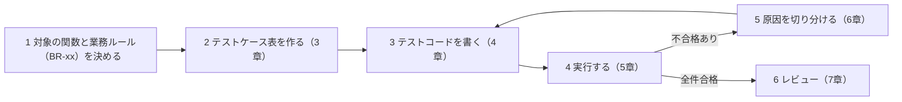

# 単体試験の書き方（経費精算システム）

| 項目 | 内容 |
|---|---|
| 管理 | 情報システム部 システム課（チーム Wiki から転記） |
| 対象システム | 経費精算システム（EXP） |
| 最終更新 | 2026-11-20 林 |

## 更新履歴

| 日付 | 内容 | 更新者 |
|---|---|---|
| 2023-02-10 | 初版（Excel のテストケース表で運用） | 木村 |
| 2024-03-08 | 観点 S-09（規程値の改定日）を追加。会議費上限改定の試験漏れを受けて | 林 |
| 2026-11-20 | 自動テスト（tests/）に移行。テストコードの規約（4章）を追加 | 林 |

## 1. この手順書の範囲

| 項目 | 内容 |
|---|---|
| 対象 | `js/logic/` と `js/core/` の関数（基本設計書 06 の 5章） |
| 対象外 | 画面の操作・表示、DB を使う処理、バッチのファイル入出力（結合試験で確認する） |
| いつ書くか | 新しい関数を作ったとき、規程改定・不具合修正で関数を変えたとき。変えた関数の試験は必ず追加・見直しする |
| 正とするもの | 基本設計書（docs/）。特に 04 業務ルール。実装の動きを正としない |

## 2. 進め方



## 3. テストケースの設計

### 3.1 同値分割

入力を「同じ結果になるはずのまとまり」に分け、まとまりごとに代表値を1つ選ぶ。

例: `judgeReceiptRequired`（BR-04）

| まとまり | 代表値 | 期待値 |
|---|---|---|
| 一般経費で必須額未満 | GEN、3,000 | 'O' |
| 一般経費で必須額以上 | GEN、8,000 | 'R' |
| 金額によらず必須の区分 | TAXI、980 | 'R' |
| 鉄道（運賃算定） | RAIL、240 | 'O' |
| 日当 | ALLOW、2,500 | 'X' |

同値分割の代表値だけでは境界の誤りは見つからない。必ず 3.2 と組み合わせる。

### 3.2 境界値

設計書の数値ごとに、境界の「1つ前・ちょうど・1つ後」の3点を試す。

| 手順 | 内容 |
|---|---|
| 1 | 設計書の書き方から、境界の値が「含まれる側」を読む（下表） |
| 2 | 1つ前・ちょうど・1つ後の値を決める。単位に注意（金額は1円、日付は1日、日時は1秒、キロは 0.1km=1） |
| 3 | 規程値は設定値マスタの値を使う。fixtures の値（初期値）で書き、値を変えた試験も1件入れる |

| 設計書の書き方 | ちょうどの値 | 例（BR） |
|---|---|---|
| 「〇〇以上」 | 含む | 領収書 5,000円以上で必須 → 4,999 は任意、5,000 は必須（BR-04） |
| 「〇〇未満」 | 含まない | 公共交通の特例 30,000円未満 → 29,999 は S10、30,000 は対象外（BR-08） |
| 「〇〇以下」 | 含む | 会議費 1人当たり 10,000円以下 → 3人 30,000 は可、30,001 は不可（BR-07） |
| 「金額下限（含む）〜金額上限（含まない）」 | 下限を含む | 承認ルート規則 → 49,999 は段数1、50,000 は段数2（BR-02） |
| 「〇日まで」「末日まで」 | 含む | 申請期限 2026-10-31 → 10-31 は期限内、11-01 は遅延（BR-03） |
| 日付と日時の比較 | 日付部分で比べる | 締め: 2026-11-30 23:59:59 は 11月分、2026-12-01 00:00:00 は 12月分（BR-10） |
| 区間の端 | 端で接するだけは重ならない | 定期区間 若松台〜中央 に対し 中央→南浜 は控除なし（BR-05） |

### 3.3 組み合わせ（デシジョンテーブル）

条件が2つ以上重なって結果が決まる判定は、条件の組み合わせを表にして漏れを防ぐ。

例: 領収書区分の入力チェック（`validateReceipt`、BR-04）

| 要否 | 明細区分 | 支払方法 | 領収書区分 | 期待 |
|---|---|---|---|---|
| 必須 | PUBT | IC | ICLOG | エラーなし |
| 必須 | PUBT | CASH | ICLOG | E-123 |
| 必須 | TAXI | IC | ICLOG | E-123 |
| 必須 | GEN | CASH | NONE | E-122 |
| 任意 | GEN | CASH | NONE | エラーなし |
| 任意 | GEN | CASH | RCPT（ファイル名なし） | E-124 |

### 3.4 システム固有の観点リスト

関数ごとに、該当する観点をすべて検討する。該当しない観点は、テストケース表の備考に「対象外（理由）」と書く。

| 観点ID | 観点 | 主な対象関数 | 確認すること | 典型的な値（fixtures の初期値） |
|---|---|---|---|---|
| S-01 | 領収書が必須になる金額のちょうど・前後 | `judgeReceiptRequired` | 一般経費と、鉄道・バス（手入力）の両方の閾値。往復は往復の合計で判定 | GEN 4,999／5,000／5,001。PUBT 29,999／30,000／30,001。PUBT 片道 15,000 往復（30,000） |
| S-02 | 領収書の代替（IC利用履歴） | `validateReceipt` | 代替できる区分・支払方法の組み合わせだけ通るか | 3.3 の表 |
| S-03 | 承認段数が切り替わる金額のちょうど・前後 | `calcRequiredLevel` | 経費種別ごとの各境界。合計金額で判定すること | GE 49,999／50,000、299,999／300,000。TR 29,999／30,000。BT 49,999／50,000、199,999／200,000 |
| S-04 | 承認段数を引き上げる条件の重なり | `calcRequiredLevel` | 金額・勘定科目・遅延の最大値になるか。どれか1つだけ、2つ、3つの場合 | 接待交際費 8,000（2）、遅延の交通費 2,000（2）、遅延の一般経費 300,000（3） |
| S-05 | 申請者本人が組織長の場合の飛ばしと繰り上げ | `buildRoute` | 本人の段を飛ばすこと、必要段数の段が無効なら上へ1人足すこと、段4 | BR-02-3 の No.7〜10 |
| S-06 | 組織長の不在・退職 | `buildRoute` | 不在・退職の段を飛ばし、繰り上げること。同じ人が続く場合に1人にまとめること | BR-02-3 の No.11・12。組織長を退職者に変えた fixtures |
| S-07 | 承認者を決められない場合 | `buildRoute` | 管理本部長本人の申請で E-129 | BR-02-3 の No.13 |
| S-08 | 通勤定期区間との重なり | `calcRailItem` | 重なりなし・端で接する・片側が区間外・両側が区間外・全区間が区間内・逆向き・別路線・定期なし | BR-05-3 の No.1〜10。特に No.2（両側が区間外で、合計が控除前の運賃を超える） |
| S-09 | 規程値・定期区間の改定日（有効期間）の前後 | `pickEffective`、`calcRailItem`、`calcFare` | 基準日が有効開始日の前日・当日で、使う行が切り替わるか。基準日がルールごとに違うこと（BR-01-3） | 佐藤の定期区間 2026-09-30／10-01（BR-05-3 No.8・9）。会議費上限 2024-03-31／04-01 |
| S-10 | 役職による日当・宿泊費上限の違い | `calcAllowance`、`calcHotel`、`findPositionAt` | 役職ごとの単価。出発日時点の役職を使うこと（昇格日をまたぐ出張） | 伊藤 2026-09-29 出発（主任）と 10-01 出発（課長）。各役職の甲地・乙地 |
| S-11 | 宿泊費の上限のちょうど・前後 | `calcHotel` | 実費 = 上限、上限 −1、上限 +1。自己負担額 | 課長・甲地 12,999／13,000／13,001 |
| S-12 | 出張の要件 | `validateTrip` | 日帰りの距離 99／100、宿泊の帰着日 = 出発日、宿泊日 = 帰着日、31日／32日 | BR-06-1 |
| S-13 | 申請期限の月末・年またぎ・うるう年 | `calcDeadline`、`isLate` | 起算日が月末・月初、12月、1月。期限日当日と翌日。判定日が初回申請日であること（再申請） | BR-03 の数値例。2028-01-15 → 2028-02-29 |
| S-14 | 締めの月末判定 | `isCloseTarget`、`payMonthOf`、`canCloseMonth` | 経理確認日時が月末日の 00:00:00・日中・23:59:59、翌月1日 00:00:00。12月 → 翌年1月 | BR-10 の数値例。`isCloseTarget({ status: '50', checkedAt: '2026-11-30 23:59:59', targetMonth: '2026-11' })` は true |
| S-15 | 会議費の1人当たり上限 | `isMealWithinLimit` | 割り切れない金額。人数 1。上限ちょうど | 3人 30,000／30,001、1人 10,000／10,001 |
| S-16 | 税区分の判定順 | `judgeTaxCategory` | BR-08-2 の順1〜6 のそれぞれ。上の条件が優先されること | 出張旅費の TAXI（S10）、交通費の PUBT 29,999（S10）／30,000（登録番号・領収書の有無で T10／N10／Z10）、租税公課（X00）、税率8% |
| S-17 | 消費税額の端数 | `calcTaxAmount` | 切り捨て。割り切れる額と割り切れない額 | 5,500→500、1,234→112、3,240（8%）→240 |
| S-18 | 登録番号の形式 | `isValidInvoiceNo` | 桁数（13／12／14桁）、先頭が小文字 t・全角Ｔ、数字以外、空 | `T0000000000001` は true |
| S-19 | 差戻し後の再申請 | `isLate`、`report-status` の関数 | 再申請日が期限後でも遅延にならないこと。前の回次の承認を引き継がないこと | 8.4（03）の No.16 |
| S-20 | 状態と操作の組み合わせ | `canDo` | 状態 × 操作 × 操作者（本人・承認者・ACCT・ADMIN）。経理担当者が自分の申請を経理確認できないこと | 02 の 5.4.3、7章 |

### 3.5 一般的な観点

| 観点ID | 観点 | 確認すること |
|---|---|---|
| G-01 | 未入力 | `null`・`undefined`・空文字・空配列を渡したときの戻り値またはエラー |
| G-02 | 型・形式 | 数字以外の文字列、不正な日付（2026-02-30） |
| G-03 | 桁・範囲 | 最小値・最大値とその外側（02 の 5.3.4 の桁） |
| G-04 | 0件・1件・複数件 | 明細・マスタの行が 0件・1件・複数件 |
| G-05 | 戻り値の型 | 金額は整数（小数にならない）、日付は `YYYY-MM-DD` の文字列 |
| G-06 | 引数を書き換えない | 実行後に引数のオブジェクト・配列が変わっていないこと |
| G-07 | マスタの設定誤り | 有効な行が 0件・2件のとき ConfigError（BR-01-4） |
| G-08 | エラーの内容 | メッセージID と明細番号が正しいこと。エラーが複数ある場合にすべて返ること |

### 3.6 テストケース表の書式

テストコードを書く前に、次の表を作ってレビューを受ける。表はテストファイルの先頭のコメントにも貼る。

| テストID | 観点ID | 分類 | 前提（fixtures・マスタ） | 入力 | 期待値 | 根拠 |
|---|---|---|---|---|---|---|
| UT-RCP-001 | S-01 | 境界（前） | 設定値 初期値 | GEN、4,999、2026-11-10 | 'O' | BR-04 |
| UT-RCP-002 | S-01 | 境界（ちょうど） | 同上 | GEN、5,000、2026-11-10 | 'R' | BR-04 |
| UT-RCP-003 | S-01 | 境界（後） | 同上 | GEN、5,001、2026-11-10 | 'R' | BR-04 |

| 列 | 書き方 |
|---|---|
| テストID | 4.2 の規則 |
| 観点ID | 3.4・3.5 の観点ID。複数ある場合はカンマ区切り |
| 分類 | 正常／異常／境界（前・ちょうど・後）／組み合わせ |
| 前提 | 使う fixtures の名前、変えたマスタの値 |
| 入力 | 関数に渡す値のうち、そのケースで意味のある値 |
| 期待値 | 設計書の数値例、または手で計算した値。計算した場合は式も書く |
| 根拠 | 業務ルールID、または 02 のチェックID |

## 4. テストコードの規約

### 4.1 ファイル配置

| 項目 | 規約 |
|---|---|
| 置き場所 | `tests/unit/` |
| ファイル名 | 対象の logic のファイル名に `.test.js` を付ける（例: `js/logic/receipt-rule.js` → `tests/unit/receipt-rule.test.js`） |
| 登録 | `tests/test.html` に `<script src="unit/receipt-rule.test.js"></script>` を追加する（対象の logic のファイルより後） |
| テストデータ | 共通のマスタは `tests/unit/fixtures.js`（4.6）を使う。そのテストだけで使う値はテストファイルの中に書く |

### 4.2 命名

テストID: `UT-{機能略号}-{連番3桁}`。連番はファイルの中で 001 から振り、欠番を作らない。

| 機能略号 | 対象ファイル |
|---|---|
| MST | master-lookup.js |
| APR | approval-route.js |
| DLN | apply-deadline.js |
| RCP | receipt-rule.js |
| RAL | rail-fare.js |
| TRV | travel-expense.js |
| GEN | general-expense.js |
| TAX | tax-category.js |
| STS | report-status.js |
| STL | settlement.js |
| RNO | report-number.js |
| VAL | report-validator.js |
| DAT | core/date-util.js |
| CSV | core/csv.js |

| 対象 | 規約 | 例 |
|---|---|---|
| `describe` の名前 | 関数名 | `'judgeReceiptRequired'` |
| `it` の名前 | `'{テストID} {条件} → {期待}'` | `'UT-RCP-002 一般経費 5,000円（必須額ちょうど） → 必須'` |

### 4.3 1ケースの書き方

| 規約 | 内容 |
|---|---|
| 1ケース1確認 | 1つの `it` で確かめる期待値は1つ（オブジェクトの比較は1つと数える） |
| 3つの段落 | 「準備（入力を作る）」「実行（関数を1回呼ぶ）」「確認（expect）」の順に書き、空行で区切る |
| 入力は値で書く | 入力の値はリテラルで書く。ループや乱数でケースを作らない |
| 期待値は値で書く | 期待値は数値・文字列のリテラルで書く。実装と同じ計算式で期待値を作らない（実装の誤りを写してしまう） |
| 独立させる | ケースの間で変数を共有して書き換えない。fixtures を変える場合は `InfoExpTest.clone()` で複製してから変える |
| 日付 | 「今日」に依存させない。業務日付は引数で固定の日付を渡す |

### 4.4 期待値の書き方

| 戻り値 | 書き方 |
|---|---|
| 数値・文字列・真偽値 | `expect(actual).toBe(5000)` |
| オブジェクト・配列 | `expect(actual).toEqual({ fare: 200, deduction: 40, unitAfter: 160, amount: 320, result: 'OK' })`。確認に関係しない項目も含め、戻り値全体を書く |
| null | `expect(actual).toBeNull()` |
| エラーの配列 | `expect(errors).toHaveError('E-122', 2)`（メッセージIDと明細番号）。エラーがないことは `toHaveNoError()` |
| ConfigError | `expect(function () { ... }).toThrowConfigError()` |

### 4.5 コード例

```js
/*
 * receipt-rule.js の単体試験
 * | テストID   | 観点ID | 分類         | 入力                 | 期待値 | 根拠  |
 * | UT-RCP-001 | S-01   | 境界（前）   | GEN、4,999           | 'O'    | BR-04 |
 * | UT-RCP-002 | S-01   | 境界（ちょうど） | GEN、5,000       | 'R'    | BR-04 |
 */
(function () {
  'use strict';
  var t = InfoExpTest;
  var rule = InfoExp.logic.receiptRule;

  t.describe('judgeReceiptRequired', function () {
    t.it('UT-RCP-001 一般経費 4,999円（必須額の1円前） → 任意', function () {
      var input = { itemKind: 'GEN', amount: 4999, minGeneral: 5000, minPublicTransport: 30000 };

      var actual = rule.judgeReceiptRequired(input);

      t.expect(actual).toBe('O');
    });

    t.it('UT-RCP-002 一般経費 5,000円（必須額ちょうど） → 必須', function () {
      var input = { itemKind: 'GEN', amount: 5000, minGeneral: 5000, minPublicTransport: 30000 };

      var actual = rule.judgeReceiptRequired(input);

      t.expect(actual).toBe('R');
    });
  });
})();
```

### 4.6 fixtures.js

`InfoExpTest.fixtures` に、基本設計書 03 の8章（初期データ）と同じ値を持つ。

| 名前 | 内容 |
|---|---|
| `orgRows` | 組織 11 件（8.2） |
| `employeeRows` | 社員 18 件（8.2） |
| `assignmentRows` | 所属・役職履歴（伊藤の昇格前の行を含む） |
| `passRows` | 通勤定期区間 5 件（8.3） |
| `stationRows`、`fareRows` | 駅 13 件、運賃 8 件（BR-05） |
| `accountRows` | 勘定科目 10 件（BR-07-1） |
| `ruleRows` | 承認ルート規則 8 件（BR-02-1） |
| `rateRows` | 日当・宿泊費基準 5 件（BR-06-3） |
| `settingRows` | 設定値 10 件（03 の 4.11） |

社員番号・駅コードなどを覚えなくてよいよう、`InfoExpTest.fixtures.emp.sato`（='100011'）、`InfoExpTest.fixtures.st.chuoMd`（='MD05'）のような別名も持つ。初期データを変えたら fixtures も同じように変える。

### 4.7 してはいけないこと

| 禁止 | 理由 |
|---|---|
| テストから DB・localStorage・画面を使う | 単体試験が遅く、不安定になる |
| `new Date()` で今日の日付を使う | 実行する日によって結果が変わる |
| 不合格になったテストの期待値を、設計書を確かめずに実装の結果に書き換える | 不具合を「仕様」として固定してしまう |
| 不合格のテストを削除・コメントアウトする | 同上。保留する場合は6章の手順で記録する |

## 5. 実行方法

| 方法 | 手順 | 結果の見方 |
|---|---|---|
| Edge で開く | エクスプローラーで `tests\test.html` をダブルクリック（既定のブラウザが Edge でない場合は右クリック →「プログラムから開く」→ Microsoft Edge） | 表の「合否」列。タブの題名が `PASS 件数/件数` なら全件合格 |
| 一部だけ実行 | アドレスバーの末尾に `?filter=RCP` を付けて再読み込み | テストID・名前に RCP を含むものだけ実行 |
| PowerShell | リポジトリのフォルダで `powershell -ExecutionPolicy Bypass -File tests\run-tests.ps1` | `FAIL` の行と最終行の `SUMMARY`。終了コード 0 なら全件合格 |

テストを追加・修正したら、必ず全件を実行する（一部だけの実行で終わらせない）。

## 6. 不合格のときの対応

| 順 | 手順 |
|---|---|
| 1 | 不合格のテストの入力・期待値を、設計書（04 の業務ルールと数値例）と見比べる |
| 2 | テストの期待値が設計書と違う → テストを直す |
| 3 | テストが設計書どおりで実装の結果が違う → 不具合。不具合票（テストID・入力・期待値・実際の値・業務ルールID）を起票し、実装を直す |
| 4 | 設計書の記述があいまいで決められない → 設計書の担当（木村）に確認する。確認が済むまでテストは残し、テスト名の末尾に `【仕様確認中】` を付ける |
| 5 | 実装を直したら全件を実行し、他のテストが不合格にならないことを確認する |

## 7. レビューのチェックリスト

| No | 確認すること |
|---|---|
| 1 | 対象の関数に関係する業務ルール（BR-xx）の数値例が、すべてテストになっているか |
| 2 | 3.4 の観点のうち対象の関数に該当するものが、すべて検討されているか（該当しない観点に理由が書かれているか） |
| 3 | 設計書の境界の値ごとに、1つ前・ちょうど・1つ後の3点があるか |
| 4 | 「以上・未満・以下・超」「日付・日時」の読み方が設計書と合っているか |
| 5 | 期待値がリテラルで書かれ、根拠（業務ルールID・計算式）が分かるか |
| 6 | テストIDが規則どおりで、`test.html` に登録されているか |
| 7 | 全件実行して合格しているか（不合格が残る場合は不具合票があるか） |
